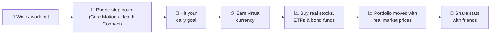
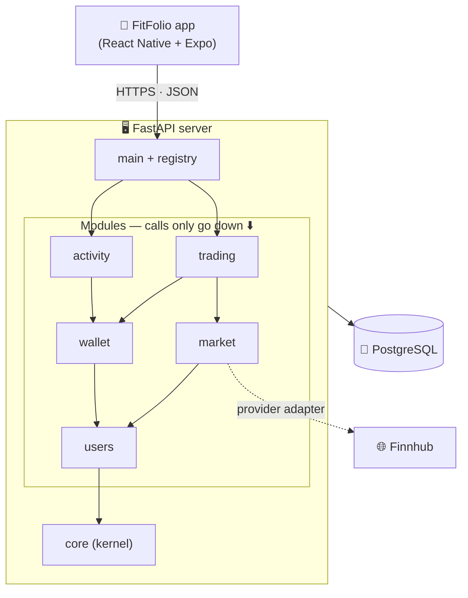

<div align="center">

# 🔥 FitFolio 💸

### Burn calories. Earn coins. Invest them in the real market.

_A mobile app that turns your daily steps into virtual currency you can invest in a portfolio of real stocks, ETFs and bond funds — so you learn investing in a low-stakes way while staying active._

<br/>

[](https://github.com/davislenover/BurnNEarn/actions/workflows/backend-ci.yml)
[](https://davislenover.github.io/BurnNEarn/)
[](https://github.com/davislenover/BurnNEarn/actions/workflows/secret-scan.yml)
[](LICENSE)


**[📚 Documentation site](https://davislenover.github.io/BurnNEarn/)** ·
**[🧱 Architecture](docs/Design/SoftArchitecture/BackendArchitecture.md)** ·
**[📱 PoC demo guide](docs/PoCDemoGuide/README.md)** ·
**[🤝 Contributing](CONTRIBUTING.md)**

</div>

---

|                   |                                                                            |
| ----------------- | -------------------------------------------------------------------------- |
| **Developers**    | Farid Bastoros, Davis Lenover, Preston Grewal, Zaid Alsaadi, Angad Chhabra |
| **Supervisor**    | Chris Schankula                                                            |
| **Project start** | September 16, 2026                                                         |

## 📖 Contents

- [🔥 FitFolio 💸](#-fitfolio-)
    - [Burn calories. Earn coins. Invest them in the real market.](#burn-calories-earn-coins-invest-them-in-the-real-market)
  - [📖 Contents](#-contents)
  - [🔄 How it works](#-how-it-works)
  - [✨ Features](#-features)
  - [🧰 Tech stack](#-tech-stack)
    - [📱 Mobile app — `src/frontend`](#-mobile-app--srcfrontend)
    - [🖥️ Backend — `src/backend`](#️-backend--srcbackend)
  - [🧱 Architecture](#-architecture)
  - [🚀 Quick start](#-quick-start)
  - [📂 Repository layout](#-repository-layout)
  - [📚 Documentation](#-documentation)
  - [👥 Team](#-team)
  - [📄 License](#-license)

## 🔄 How it works



1. **Move.** FitFolio reads your steps automatically from your phone (Core Motion on iPhone, Health Connect on Android), so there's nothing to log by hand.
2. **Earn.** The server turns your daily step total into virtual credits, up to a daily limit.
3. **Invest.** Spend that currency on a virtual portfolio of real assets whose value follows real market prices.
4. **Learn.** Try simulated market scenarios, like replays of past downturns, and see how your portfolio holds up.
5. **Share.** Post selected workout and portfolio stats to a social feed with friends.

## ✨ Features

|     | Feature                                                                             |   Status   |
| --- | ----------------------------------------------------------------------------------- | :--------: |
| 🚶  | Daily step tracking (Core Motion on iPhone, Health Connect on Android)              |   ✅ PoC   |
| 🪙  | Step rewards: daily totals become credits, with a daily cap and a 7-day sync window |   ✅ PoC   |
| 👛  | Wallet with exact money handling and a full balance history                         |   ✅ PoC   |
| 📈  | Live market prices (Finnhub, with a fake provider for offline dev)                  |   ✅ PoC   |
| 🛒  | Buying shares: balance and shares change in one atomic transaction                  |   ✅ PoC   |
| 📊  | Portfolio with holdings and their current value                                     |   ✅ PoC   |
| 💰  | Selling shares                                                                      | ⏳ Planned |
| 🏋️  | Workouts and other fitness goals beyond steps                                       | ⏳ Planned |
| 🔐  | User accounts and sign-in (the PoC uses one built-in demo user)                     | ⏳ Planned |
| 📉  | Simulated market scenarios (replays of past downturns)                              | ⏳ Planned |
| 👥  | Social feed for sharing workout and portfolio stats                                 | ⏳ Planned |
| 🧭  | Full app screens and navigation (the PoC has a single demo screen)                  | ⏳ Planned |

## 🧰 Tech stack

<table>
<tr>
<td valign="top" width="50%">

### 📱 Mobile app — [`src/frontend`](src/frontend)

- **React Native** + **Expo** (dev client) for iOS and Android
- **TypeScript**
- **expo-sensors** Pedometer (Core Motion) on iOS and **react-native-health-connect** on Android for steps
- **Jest** (`jest-expo`) for tests

</td>
<td valign="top" width="50%">

### 🖥️ Backend — [`src/backend`](src/backend)

- **FastAPI** REST API (JSON over HTTPS)
- **PostgreSQL** + **SQLAlchemy 2** + **Alembic** migrations
- **uv** for Python packaging, **Docker Compose** for the database
- **pytest**, **Ruff**, **import-linter** in CI

</td>
</tr>
</table>

## 🧱 Architecture

The phone app is the client; it talks to one backend server through a REST API. The server is a **modular monolith on a small kernel**: one FastAPI process and one PostgreSQL database, split into feature modules that each own their own tables.



- **Layers** — modules are stacked and only call downward (trading uses market, never the reverse). CI enforces this with `import-linter`.
- **Plug-ins** — each module registers its routes through its own `plugin.py`, listed in `app/registry.py`.
- **Kernel** — `app/core/` holds what every module shares and never imports a module.
- **Adapter** — market data comes through a provider class, so Finnhub can be swapped out without touching other modules.
- **Why not microservices?** A buy must change the balance and the shares in one database transaction (`FR_MktAtomicTrade`).

👉 Full details, per-module docs and UML diagrams: **[BackendArchitecture.md](docs/Design/SoftArchitecture/BackendArchitecture.md)**

## 🚀 Quick start

> **Prerequisites:** [uv](https://docs.astral.sh/uv/), Docker (or OrbStack), and [Node.js 24](https://nodejs.org/en/download).

<details open>
<summary><b>🖥️ Backend</b></summary>

```bash
cd src/backend
cp .env.example .env                       # Windows: Copy-Item .env.example .env
uv sync
docker compose up -d --wait                # start PostgreSQL
uv run alembic upgrade head                # apply migrations
uv run python -m app.scripts.seed_demo     # add the demo user
uv run uvicorn app.main:app --reload
```

Then open **<http://127.0.0.1:8000/docs>** to try the API.
Full setup, including running against a real phone: [`src/backend/README.md`](src/backend/README.md).

</details>

<details>
<summary><b>📱 Mobile app</b></summary>

```bash
cd src/frontend
npm ci
npx expo run:android            # build and install on an Android emulator or phone
npx expo start --dev-client     # later runs: start the bundler for the installed build
```

The app uses native modules for step tracking, so it runs as its own **development build**, not in Expo Go. On iPhone it's built with `npx expo prebuild --platform ios` and installed from Xcode.
Full setup: [`src/frontend/README.md`](src/frontend/README.md) · Demo walkthrough: [Android](docs/PoCDemoGuide/Android.md) / [iOS](docs/PoCDemoGuide/iOS.md).

</details>

<details>
<summary><b>✅ Checks (run before you push)</b></summary>

```bash
cd src/backend
uv run pytest
uv run ruff check --config pyproject.toml . ../../test/backend
uv run ruff format --config pyproject.toml . ../../test/backend
uv run lint-imports
uv run alembic check
```

CI runs all of these on every pull request, and also rolls every migration back and forward again.

</details>

## 📂 Repository layout

```text
BurnNEarn/
├── 📁 docs/        Project documentation (LaTeX sources)
│   ├── SRS-IEEE/           Software Requirements Specification
│   ├── HazardAnalysis/     Hazard Analysis (FMEA)
│   ├── VnVPlan/            Verification & Validation Plan
│   ├── Design/             Module Guide (MG), MIS, backend architecture
│   ├── PoCDemoGuide/       How to run the proof-of-concept demo
│   └── CDs/                Custom documents (Design Thinking, Usability, …)
├── 📁 pdfs/        Built PDFs of every document
├── 📁 refs/        Reference material and bibliography
├── 📁 src/
│   ├── backend/            FastAPI server (core, users, wallet, market, trading, activity)
│   └── frontend/           React Native + Expo mobile app
├── 📁 test/        Automated tests (backend/, frontend/)
└── 📁 site/        Docs landing page for GitHub Pages
```

## 📚 Documentation

Every document is built to PDF by CI and published on the **[project site](https://davislenover.github.io/BurnNEarn/)**.

| Document                            | Source                                                                    |                                 PDF                                 |
| ----------------------------------- | ------------------------------------------------------------------------- | :-----------------------------------------------------------------: |
| Problem Statement & Goals           | [tex](docs/ProblemStatementAndGoals/ProblemStatement.tex)                 |      [📄](pdfs/ProblemStatementAndGoals/ProblemStatement.pdf)       |
| Development Plan                    | [tex](docs/DevelopmentPlan/DevelopmentPlan.tex)                           |           [📄](pdfs/DevelopmentPlan/DevelopmentPlan.pdf)            |
| Software Requirements Specification | [tex](docs/SRS-IEEE/SRS.tex)                                              |                     [📄](pdfs/SRS-IEEE/SRS.pdf)                     |
| Hazard Analysis                     | [tex](docs/HazardAnalysis/HazardAnalysis.tex)                             |            [📄](pdfs/HazardAnalysis/HazardAnalysis.pdf)             |
| V&V Plan                            | [tex](docs/VnVPlan/VnVPlan.tex)                                           |                   [📄](pdfs/VnVPlan/VnVPlan.pdf)                    |
| Module Guide (MG)                   | [tex](docs/Design/SoftArchitecture/MG.tex)                                |              [📄](pdfs/Design/SoftArchitecture/MG.pdf)              |
| Module Interface Spec (MIS)         | [tex](docs/Design/SoftDetailedDes/MIS.tex)                                |              [📄](pdfs/Design/SoftDetailedDes/MIS.pdf)              |
| Backend Architecture                | [md](docs/Design/SoftArchitecture/BackendArchitecture.md)                 |     [📄](pdfs/Design/SoftArchitecture/BackendArchitecture.pdf)      |
| PoC Demo Guide                      | [Android](docs/PoCDemoGuide/Android.md) · [iOS](docs/PoCDemoGuide/iOS.md) | [📄](pdfs/PoCDemoGuide/Android.pdf) [📄](pdfs/PoCDemoGuide/iOS.pdf) |
| V&V Report                          | [tex](docs/VnVReport/VnVReport.tex)                                       |                 [📄](pdfs/VnVReport/VnVReport.pdf)                  |
| User Guide                          | [tex](docs/UserGuide/UserGuide.tex)                                       |                 [📄](pdfs/UserGuide/UserGuide.pdf)                  |
| Reflection & Traceability           | [tex](docs/ReflectAndTrace/ReflectAndTrace.tex)                           |           [📄](pdfs/ReflectAndTrace/ReflectAndTrace.pdf)            |

## 👥 Team

<div align="center">

| Farid Bastoros | Davis Lenover | Preston Grewal | Zaid Alsaadi | Angad Chhabra |
| :------------: | :-----------: | :------------: | :----------: | :-----------: |

**Supervised by Chris Schankula**

</div>

Want to help out? Read the [Contributing guide](CONTRIBUTING.md) and our [Code of Conduct](CodeOfConduct.md).

## 📄 License

Released under the [MIT License](LICENSE) © 2026 the FitFolio team.

<div align="center">
<sub>Built with ☕ and 🏃 at McMaster University</sub>
</div>
