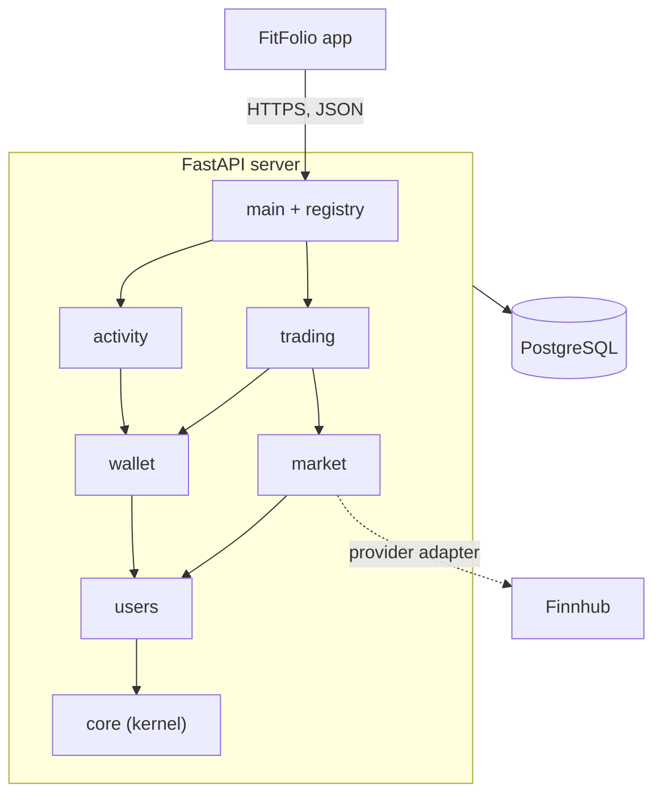

# FitFolio

A mobile app that turns daily steps into virtual currency you can invest in a portfolio of real stocks, ETFs and bond funds, so people can stay active and learn about investing at no financial risk.

[](https://github.com/davislenover/BurnNEarn/actions/workflows/backend-ci.yml)
[](https://davislenover.github.io/BurnNEarn/)
[](https://github.com/davislenover/BurnNEarn/actions/workflows/secret-scan.yml)
[](LICENSE)


|                   |                                                                            |
| ----------------- | -------------------------------------------------------------------------- |
| **Developers**    | Farid Bastoros, Davis Lenover, Preston Grewal, Zaid Alsaadi, Angad Chhabra |
| **Supervisor**    | Chris Schankula                                                            |
| **Project start** | September 16, 2026                                                         |
| **Course**        | McMaster University, Software Engineering Capstone                         |

[Documentation site](https://davislenover.github.io/BurnNEarn/) ·
[Architecture](docs/Design/SoftArchitecture/BackendArchitecture.md) ·
[PoC demo guide](docs/PoCDemoGuide/README.md) ·
[Contributing](CONTRIBUTING.md)

## Contents <!-- omit from toc -->

- [How it works](#how-it-works)
- [Features](#features)
- [Tech stack](#tech-stack)
- [Architecture](#architecture)
- [Quick start](#quick-start)
  - [Backend](#backend)
  - [Mobile app](#mobile-app)
  - [Checks before pushing](#checks-before-pushing)
- [Repository layout](#repository-layout)
- [Documentation](#documentation)
- [License](#license)

## How it works

1. **Move.** FitFolio reads your steps automatically from your phone (Core Motion on iPhone, Health Connect on Android).
2. **Earn.** The server turns your daily step total into virtual credits, up to a daily limit.
3. **Invest.** Spend the credits on a virtual portfolio of real assets whose value follows real market prices.
4. **Learn.** Try simulated market scenarios, such as replays of past downturns, and see how your portfolio holds up.
5. **Share.** Post selected workout and portfolio statistics to a feed with friends.

## Features

| Feature                                                                             | Status      |
| ----------------------------------------------------------------------------------- | ----------- |
| Daily step tracking (Core Motion on iPhone, Health Connect on Android)              | Done in PoC |
| Step rewards: daily totals become credits, with a daily cap and a 7-day sync window | Done in PoC |
| Wallet with exact money handling and a full balance history                         | Done in PoC |
| Live market prices from Finnhub, with a fake provider for offline development       | Done in PoC |
| Buying shares, with the balance and shares changed in one atomic transaction        | Done in PoC |
| Portfolio with holdings and their current value                                     | Done in PoC |
| Selling shares                                                                      | Planned     |
| Workouts and other fitness goals beyond steps                                       | Planned     |
| User accounts and sign-in (the PoC uses one built-in demo user)                     | Planned     |
| Simulated market scenarios                                                          | Planned     |
| Social feed                                                                         | Planned     |
| Full app screens and navigation (the PoC has a single demo screen)                  | Planned     |

## Tech stack

|                                                 |                                                                                                                  |
| ----------------------------------------------- | ---------------------------------------------------------------------------------------------------------------- |
| **Mobile app** ([`src/frontend`](src/frontend)) | React Native and Expo (development build), TypeScript, Expo Pedometer on iOS and Health Connect on Android, Jest |
| **Backend** ([`src/backend`](src/backend))      | Python 3.14, FastAPI, PostgreSQL, SQLAlchemy 2, Alembic                                                          |
| **Tooling**                                     | uv, Docker Compose, pytest, Ruff, import-linter, gitleaks, GitHub Actions                                        |

## Architecture

The phone app is the client and talks to one backend server through a REST API. The server is a modular monolith on a small kernel: one FastAPI process and one PostgreSQL database, split into feature modules that each own their own tables.



- **Layers:** modules only call downward (trading uses market, never the reverse). CI enforces this with `import-linter`.
- **Plug-ins:** each module registers its routes through its own `plugin.py`, listed in `app/registry.py`.
- **Kernel:** `app/core/` holds what every module shares and never imports a module.
- **Adapter:** market data comes through a provider class, so Finnhub can be replaced without changing other modules.
- **Why not microservices:** a purchase must change the balance and the shares in one database transaction (`FR_MktAtomicTrade`).

Full details, per-module documents and UML diagrams are in [BackendArchitecture.md](docs/Design/SoftArchitecture/BackendArchitecture.md).

## Quick start

Prerequisites: [uv](https://docs.astral.sh/uv/), Docker (or OrbStack), and [Node.js 24](https://nodejs.org/en/download).

### Backend

```bash
cd src/backend
cp .env.example .env                       # Windows: Copy-Item .env.example .env
uv sync
docker compose up -d --wait                # start PostgreSQL
uv run alembic upgrade head                # apply migrations
uv run python -m app.scripts.seed_demo     # add the demo user
uv run uvicorn app.main:app --reload
```

Then open <http://127.0.0.1:8000/docs> to try the API. Full setup, including running against a real phone, is in [`src/backend/README.md`](src/backend/README.md).

### Mobile app

```bash
cd src/frontend
npm ci
npx expo run:android            # build and install on an Android emulator or phone
npx expo start --dev-client     # later runs: start the bundler for the installed build
```

The app uses native modules for step tracking, so it runs as its own development build, not in Expo Go. On iPhone it is built with `npx expo prebuild --platform ios` and installed from Xcode. See [`src/frontend/README.md`](src/frontend/README.md) and the demo guides for [Android](docs/PoCDemoGuide/Android.md) and [iOS](docs/PoCDemoGuide/iOS.md).

### Checks before pushing

```bash
cd src/backend
uv run pytest
uv run ruff check --config pyproject.toml . ../../test/backend
uv run ruff format --config pyproject.toml . ../../test/backend
uv run lint-imports
uv run alembic check
```

CI runs all of these on every pull request, and also rolls every migration back and forward again.

## Repository layout

```text
BurnNEarn/
├── docs/                   Project documentation (LaTeX sources)
│   ├── SRS-IEEE/           Software Requirements Specification
│   ├── HazardAnalysis/     Hazard Analysis (FMEA)
│   ├── VnVPlan/            Verification and Validation Plan
│   ├── Design/             Module Guide (MG), MIS, backend architecture
│   ├── PoCDemoGuide/       How to run the proof-of-concept demo
│   └── CDs/                Custom documents
├── pdfs/                   Built PDFs of every document
├── refs/                   Reference material and bibliography
├── src/
│   ├── backend/            FastAPI server
│   └── frontend/           React Native and Expo mobile app
├── test/                   Automated tests
└── site/                   Landing page for GitHub Pages
```

## Documentation

Every document is built to PDF by CI and published on the [project site](https://davislenover.github.io/BurnNEarn/).

| Document                            | Source                                                                   | PDF                                                                        |
| ----------------------------------- | ------------------------------------------------------------------------ | -------------------------------------------------------------------------- |
| Problem Statement and Goals         | [tex](docs/ProblemStatementAndGoals/ProblemStatement.tex)                | [pdf](pdfs/ProblemStatementAndGoals/ProblemStatement.pdf)                  |
| Development Plan                    | [tex](docs/DevelopmentPlan/DevelopmentPlan.tex)                          | [pdf](pdfs/DevelopmentPlan/DevelopmentPlan.pdf)                            |
| Software Requirements Specification | [tex](docs/SRS-IEEE/SRS.tex)                                             | [pdf](pdfs/SRS-IEEE/SRS.pdf)                                               |
| Hazard Analysis                     | [tex](docs/HazardAnalysis/HazardAnalysis.tex)                            | [pdf](pdfs/HazardAnalysis/HazardAnalysis.pdf)                              |
| Verification and Validation Plan    | [tex](docs/VnVPlan/VnVPlan.tex)                                          | [pdf](pdfs/VnVPlan/VnVPlan.pdf)                                            |
| Module Guide                        | [tex](docs/Design/SoftArchitecture/MG.tex)                               | [pdf](pdfs/Design/SoftArchitecture/MG.pdf)                                 |
| Module Interface Specification      | [tex](docs/Design/SoftDetailedDes/MIS.tex)                               | [pdf](pdfs/Design/SoftDetailedDes/MIS.pdf)                                 |
| Backend Architecture                | [md](docs/Design/SoftArchitecture/BackendArchitecture.md)                | [pdf](pdfs/Design/SoftArchitecture/BackendArchitecture.pdf)                |
| PoC Demo Guide                      | [Android](docs/PoCDemoGuide/Android.md), [iOS](docs/PoCDemoGuide/iOS.md) | [Android](pdfs/PoCDemoGuide/Android.pdf), [iOS](pdfs/PoCDemoGuide/iOS.pdf) |
| Verification and Validation Report  | [tex](docs/VnVReport/VnVReport.tex)                                      | [pdf](pdfs/VnVReport/VnVReport.pdf)                                        |
| User Guide                          | [tex](docs/UserGuide/UserGuide.tex)                                      | [pdf](pdfs/UserGuide/UserGuide.pdf)                                        |
| Reflection and Traceability         | [tex](docs/ReflectAndTrace/ReflectAndTrace.tex)                          | [pdf](pdfs/ReflectAndTrace/ReflectAndTrace.pdf)                            |

To contribute, read the [Contributing guide](CONTRIBUTING.md) and the [Code of Conduct](CodeOfConduct.md).

## License

Released under the [MIT License](LICENSE).
