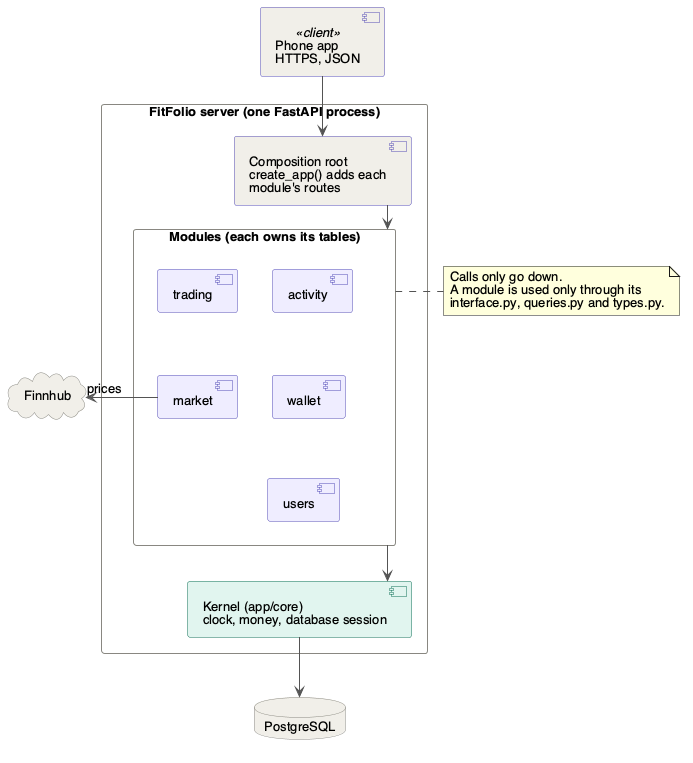

# FitFolio backend architecture

| Date | Version | Author | Notes |
|---|---|---|---|
| Nov 5, 2026 | 1.0 | Davis Lenover | PoC version |

This covers only what the PoC needs. It grows as features are added.

## Architecture

**Client–server.** The phone app is the client. It talks to one backend server
over HTTPS, sending and receiving JSON (a REST API).

**The server is a modular monolith on a small kernel.** It is one FastAPI
process with one PostgreSQL database, split into modules.
- **Modules:** one per feature. Each is a folder in `src/backend/app/` and
  owns its own tables.
- **Layers:** modules are stacked, and calls only go down. Trading calls
  market, but market never calls trading.
- **Public interfaces:** other modules use a module only through its public
  files.
- **Kernel:** `app/core/` holds what every module shares, and never imports a
  module.
- **Plug-ins:** each module adds its routes to the app through its
  `plugin.py`, which is listed in `app/registry.py`.
- **Adapter:** market gets prices through a provider class, so Finnhub can be
  swapped for another provider without changing other modules.

The server isn't split into separate services, because a buy must change the
balance and the shares in one database transaction (FR_MktAtomicTrade). CI
rejects any import that breaks these rules.



The rows inside "Modules" show the stacking. Trading uses market and wallet,
activity uses wallet, and wallet uses users. Every module with routes also uses users to
get the current user.

The diagram's source is `figures/backend-poc.puml`. After changing it, run
this from the repository root to update the PNG:

```bash
plantuml -tpng docs/Design/SoftArchitecture/figures/backend-poc.puml
```

## A module's files

| File | What it holds | Other modules may import it |
|---|---|---|
| `interface.py` | Functions other modules may call | Yes |
| `queries.py` | Reads other modules may call. They never write | Yes |
| `types.py` | Data classes and errors | Yes |
| `service.py` | The rules. Never commits | No |
| `models.py` | The tables | No |
| `routes.py` | HTTP routes. Commits once | No |
| `plugin.py` | Adds the module's routes to the app | No, only `app/registry.py` |

Leave out any file a module doesn't need.

## Rules

1. Import another module only through its `interface.py`, `queries.py` or
   `types.py`.
2. Never import a module above yours in the diagram.
3. Never use another module's tables. A foreign key into them is fine, such
   as `trades.asset_id` to `assets`.
4. Only routes commit, and only once.
5. Money only moves through wallet. Lock the portfolio first with
   `wallet.interface.lock_live_portfolio()`. `change_balance` needs what it
   returns. This way a buy and a step sync at the same time wait in turn
   instead of deadlocking.
6. Take the time from `app/core/clock.py`, never from `datetime.now()`, so
   tests can set it.

## What the PoC builds

| Folder | Owns these tables | Routes | Issue |
|---|---|---|---|
| `app/core/`, `app/registry.py`, `app/main.py` | none | `GET /v1/health` | #187, first pull request |
| `app/market/` | `assets`, `prices`, `provider_requests` | `GET /v1/assets`, `GET /v1/market/usage` | #187 |
| `app/users/` | `users` | none (it provides the demo user) | #189 |
| `app/wallet/` | `portfolios`, `balance_changes` | `GET /v1/me/balance` | #189 |
| `app/activity/` | `activity_daily_totals` | `PUT /v1/me/activity/daily-totals` | #190 |
| `app/trading/` | `trades`, `holdings` | `POST /v1/me/trades`, `GET /v1/me/portfolio` | #188 |

#187's first pull request sets up the shared pieces. It moves `Money` from
`app/api/` into `app/core/`, and the health route into `app/core/routes.py`.
It adds `app/core/clock.py` and `app/registry.py`, the list of modules. It also
adds `create_app()` in `app/main.py`, which adds each module's routes, and
`app = create_app()` keeps `uv run uvicorn app.main:app` working. The price
poller is market's own background thread, which market's plugin starts and
stops with the app.

#191 adds two checks to CI:
- an import-linter rule: no module imports one above it, and `app/core/`
  imports no module
- a test: modules import each other only through their public files

## Migrations

There is still one chain, and 0001 to 0003 don't change. Name each new
migration after its module:

```bash
uv run alembic revision --autogenerate --rev-id market_0001 -m "provider requests"
```

If `main` gets a new migration while you work, set your migration's
`down_revision` to it before you merge. The backend README shows how.
