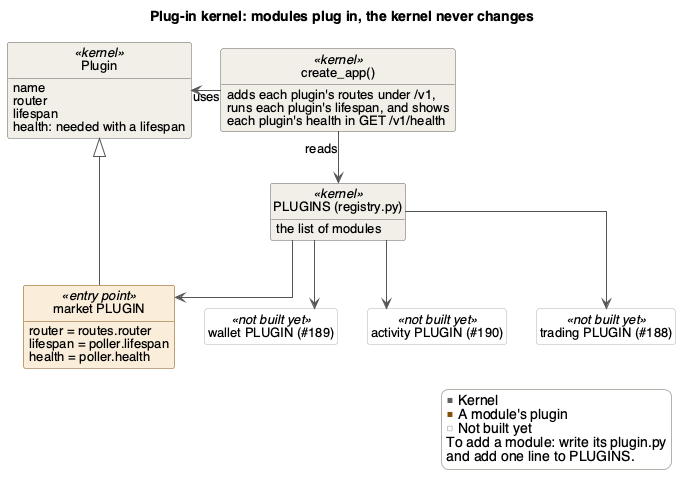
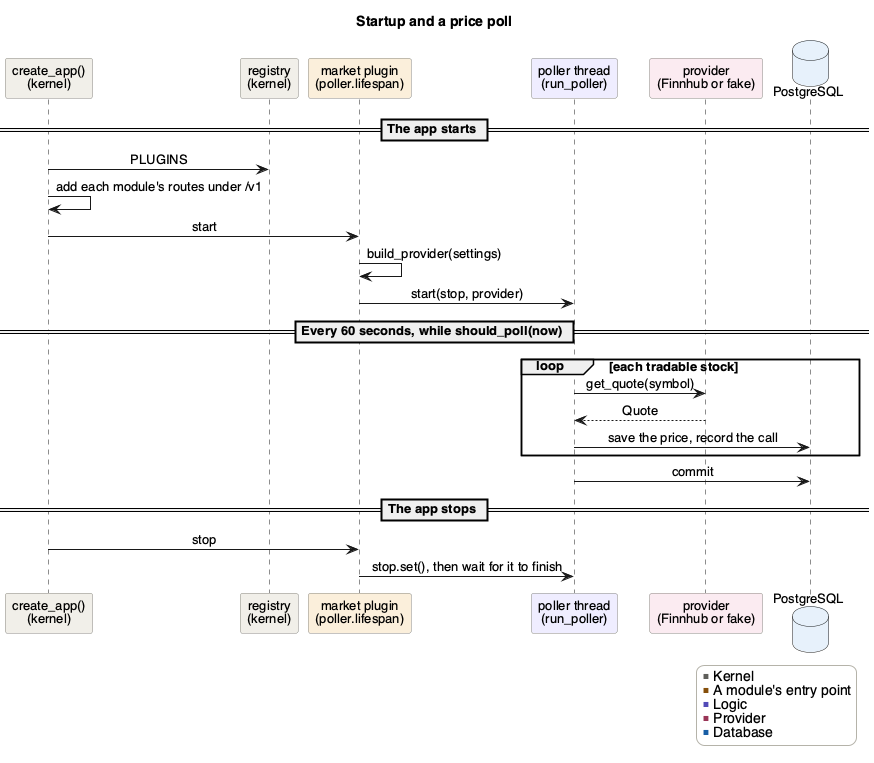
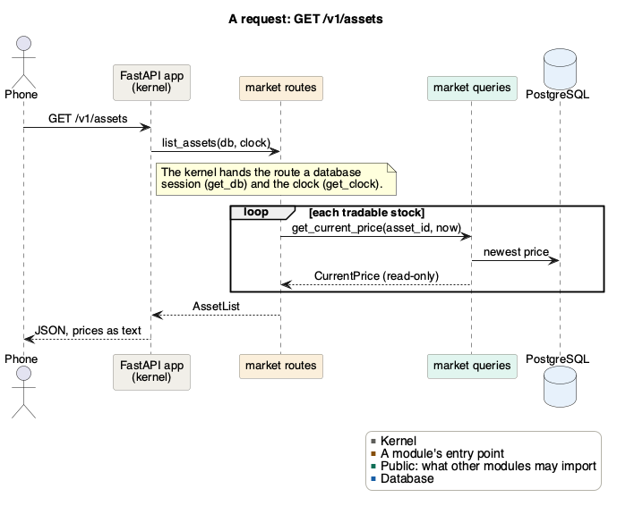

# FitFolio backend architecture

| Date | Version | Author | Notes |
|---|---|---|---|
| Nov 5, 2026 | 1.0 | Davis Lenover | PoC version |
| Nov 7, 2026 | 1.1 | Davis Lenover | Module health, users and wallet |
| Nov 8, 2026 | 1.2 | Davis Lenover | Trading |
| Nov 8, 2026 | 1.3 | Davis Lenover | One doc per module, access specifiers in the class diagrams |
| Nov 10, 2026 | 1.4 | Davis Lenover | Technology, and why each was chosen |

This is the high-level view. Each module is explained in its own doc, linked
below. It covers only what the PoC needs, and grows as features are added.

## Architecture

**Client–server.** The phone app is the client. It talks to one backend server
over HTTPS, sending and receiving JSON (a REST API).

**The server is a modular monolith on a small kernel.** It is one FastAPI
process with one PostgreSQL database, split into modules.
- **Modules:** one per feature. Each is a folder in `src/backend/app/` and
  owns its own tables.
- **Layers:** modules are stacked, and calls only go down. Trading calls
  market, but market never calls trading.
- **Public interfaces:** other modules use a module only through its public
  files.
- **Kernel:** `app/core/` holds what every module shares, and never imports a
  module.
- **Plug-ins:** each module adds its routes to the app through its
  `plugin.py`, which is listed in `app/registry.py`.
- **Adapter:** market gets prices through a provider class, so Finnhub can be
  swapped for another provider without changing other modules.

The server isn't split into separate services, because a buy must change the
balance and the shares in one database transaction (FR_MktAtomicTrade). CI
rejects any import that breaks these rules.


The rows inside "Modules" show the stacking. Trading uses market and wallet,
activity uses wallet, and wallet uses users. Wallet and trading also use users
to get the current user. Market's routes need no user.

The diagram's source is `figures/backend-poc.puml`. After changing a diagram,
run this from the repository root to update its PNG:

```bash
plantuml -tpng docs/Design/SoftArchitecture/figures/backend-poc.puml
```

## Technology

The Development Plan (Section 10, Expected Technology) gives the reasons for
Python, FastAPI, PostgreSQL, pytest and Ruff, and their alternatives. The
rest were chosen while building the PoC. In short:

- **Python 3.14** is the programming language the server is written in. Its
  libraries cover each of the server's jobs: calling Finnhub, serving the
  API, and later NumPy and pandas for market scenarios (FR_MktScenario).
  TypeScript would have matched the app, but Python's numerical libraries
  suit the simulation better.
- **FastAPI** is a Python web framework, a library for writing the routes of
  an API. **Uvicorn** is the web server that runs it.
  - It checks every request against the route's types before our code runs,
    so a malformed request is refused (SEC-25).
  - Its `Depends` hands each route its session, clock and user, so a test can
    swap them (dependency injection).
  - It writes the API's docs at `/docs` from the same types, so the app and
    the server agree on what is sent.
  - Django with Django REST Framework was the alternative, but Django brings
    much the project doesn't need, such as server-rendered pages.
- **Pydantic** is a library that checks data against declared types, such as
  a field that must be a decimal. `Money` uses it to refuse an amount with
  over 4 decimals (NFR_Accuracy). pydantic-settings, its add-on for
  settings, reads `.env` and keeps the Finnhub key a `SecretStr`, which
  prints as stars (SEC-33).
- **PostgreSQL 18** is a relational database: data lives in tables of rows
  and columns, and a row can point at a row in another table. It holds every
  module's tables.
  - The data is relational (users, portfolios, trades), and one transaction
    saves a buy's payment and shares together or not at all
    (FR_MktAtomicTrade).
  - It stores money as exact `NUMERIC` (NFR_Accuracy), and locks a
    portfolio's row so requests for it take turns (rule 5).
  - It checks each table's constraints, such as a balance never below 0, on
    every write, even for code that skips a module's own checks.
  - MongoDB was the alternative, but this data is relational.
- **Docker** runs a program in a container: a packaged copy of the program
  with everything it needs, kept apart from the rest of your computer. Here
  it runs PostgreSQL. `docker compose up -d` in `src/backend/` starts the same
  `postgres:18` image that CI tests against, so your database matches CI's,
  with nothing to install but Docker. Its credentials are for local use only.
- **SQLAlchemy 2** is a library for using a SQL database from Python. Each
  table is a Python class, and queries are Python code rather than strings of
  SQL. Each module defines its tables as typed classes on one `Base`, which
  names every constraint and index the same way. A session saves a request's
  changes in one commit (rule 4).
- **Alembic** is SQLAlchemy's migration tool. A migration is a small script
  that changes the database's tables, such as adding a column or a check, and
  can undo that change. Alembic keeps them in one chain, each naming the one
  before it, and `alembic upgrade head` runs the ones a database hasn't had
  yet. So a database that holds data, such as a deployed one, changes
  without being rebuilt, and every developer's database ends up like CI's.
  CI checks there is one chain, that it upgrades and downgrades, and that it
  matches the models (`alembic check`).
- **httpx2** is a library for making HTTP requests from Python. It calls
  Finnhub with a 10 second timeout, and lets tests answer in Finnhub's place
  (`MockTransport`).
- **uv** is a tool that installs Python and a project's packages. It installs
  them from `uv.lock`, the list of exact versions, so everyone and CI get the
  same ones (`uv sync --locked`).
- **pytest** is a framework for writing and running tests, with little
  boilerplate. **Ruff** checks code for mistakes and style (a linter) and
  formats it, in one fast tool. **import-linter** checks which packages may
  import which, and fails CI when a module imports one above it (rule 2).

## Modules

| Module | What it does | Owns these tables | Routes | Issue |
|---|---|---|---|---|
| [Kernel](modules/core.md) (`app/core/`) | What every module shares | none | `GET /v1/health` | #187 |
| [Users](modules/users.md) | Who is calling | `users` | none | #279 |
| [Wallet](modules/wallet.md) | Each portfolio's currency, and the one safe way to change it | `portfolios`, `balance_changes` | `GET /v1/me/balance` | #279, #189 |
| [Market](modules/market.md) | Stocks and their prices | `assets`, `prices`, `provider_requests` | `GET /v1/assets`, `GET /v1/market/usage` | #187 |
| [Trading](modules/trading.md) | Buying shares, and what a portfolio is worth | `trades`, `holdings` | `POST /v1/me/trades`, `GET /v1/me/portfolio` | #188 |
| Activity | Step rewards | `activity_daily_totals` | `PUT /v1/me/activity/daily-totals` | #190, not built yet |

Each module's pull request adds or updates its doc in `modules/`, and its UML
class diagram in `figures/`.

## A module's files

| File | What it holds | Other modules may import it |
|---|---|---|
| `interface.py` | Functions other modules may call | Yes |
| `queries.py` | Reads other modules may call. They never write | Yes |
| `types.py` | Data classes and errors | Yes |
| `service.py` | The rules. Never commits | No |
| `models.py` | The tables | No |
| `routes.py` | HTTP routes. Commits once | No |
| `plugin.py` | Adds the module to the app: its routes, background work and health check | No, only `app/registry.py` |

Leave out any file a module doesn't need.

## How to read the class diagrams

Each kind of box has one color in every diagram, shown in its legend. For
example, an entry point is orange, a public file green, logic purple, a table
or record blue and an error red. An arrow means "uses", and a hollow
arrowhead means "is a".

Each member has an access specifier. In a box for a file, it follows the
import rules below:
- `+` **public:** other modules may use it, because it is in the module's
  `interface.py`, `queries.py` or `types.py`. A route is `+` too, since the
  phone uses it.
- `~` **module:** only the module's own files may use it, such as everything
  in `service.py` and `models.py`.
- `-` **private:** only its own file uses it. In Python its name starts with
  `_`.

In a box for a class, such as a record, a table, an error or a provider, `+`
is a member that anyone holding one may use, and `-` is one whose name starts
with `_`. Which file the class is in says who may import it.

## Rules

1. Import another module only through its `interface.py`, `queries.py` or
   `types.py`.
2. Never import a module above yours in the diagram.
3. Never use another module's tables. A foreign key into them is fine, such
   as `trades.asset_id` to `assets`.
4. A route commits once per request. Code that answers no request commits
   once for each piece of work, in its own session, such as each of market's
   polls or one run of `seed_demo`. Nothing below them commits.
5. Money only moves through wallet. Lock the portfolio with
   `wallet.interface.lock_live_portfolio()` before calling `change_balance`,
   as [wallet](modules/wallet.md#changing-a-balance) shows.
6. Take the time from `app/core/clock.py`, never from `datetime.now()`, so
   tests can set it.

CI checks rules 1 and 2. import-linter (`uv run lint-imports`) refuses an
import of a module above, or of any module from `app/core/`.
`test_public_files.py` refuses an import of another module's other files.

## Design patterns

**Plug-in kernel.** The kernel (`app/core/` and `create_app()`) doesn't know
which modules exist. Each module fills in a `Plugin` in its `plugin.py`, with
its routes, any work that runs in the background, and a health check, and
`app/registry.py` lists them. Adding a module never changes the kernel.
See [the kernel](modules/core.md).



**Strategy, adapter and factory.** Market asks for prices through one
interface, `MarketDataProvider`. `FinnhubProvider` adapts Finnhub's API to
it, `FakeProvider` makes up prices, and `build_provider` picks one from
`MARKET_PROVIDER`. Each provider gives its own request limit, so a new one
changes no code outside `market/providers/`. See [market](modules/market.md).

**Dependency injection.** Code is handed what it needs instead of fetching
it. Routes get a database session and the clock from the kernel, through
`Depends(get_db)` and `Depends(get_clock)`, and the current user from users,
through `Depends(get_current_user)`. The poller is given its provider,
clock and session factory. Tests hand in stand-ins, such as a fixed time or a
stub provider.

**Read-only records.** A module hands other modules frozen copies, such as
market's `CurrentPrice` or wallet's `BalanceChangeReceipt`, never database
rows. That way no module can change another module's tables by accident.

**Lock token.** Wallet's `change_balance` only takes the `LockedPortfolio`
that `lock_live_portfolio` returns, so changing a balance without locking it
first is hard to do by accident. See [wallet](modules/wallet.md).

**Idempotency key.** Each buy carries a `request_id` from the phone, so a
retried request gets its first answer back instead of buying twice. See
[trading](modules/trading.md).

## How it runs

When the app starts, the kernel adds each module's routes and starts each
module's background work. For market, that is the poller thread, which saves
a price for every stock once a minute while the market is open.



A request goes from the kernel to the module's route, which reads through the
module's queries.



## Migrations

There is still one chain, and 0001 to 0003 don't change. Each new migration
is named after its module and numbered within it, such as `market_0002`. If
`main` gets a new migration while you work, set your migration's
`down_revision` to it before you merge, and keep its name. The
[backend README](../../../src/backend/README.md#change-the-database) shows the
commands.
