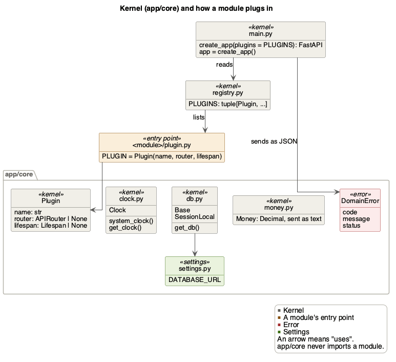
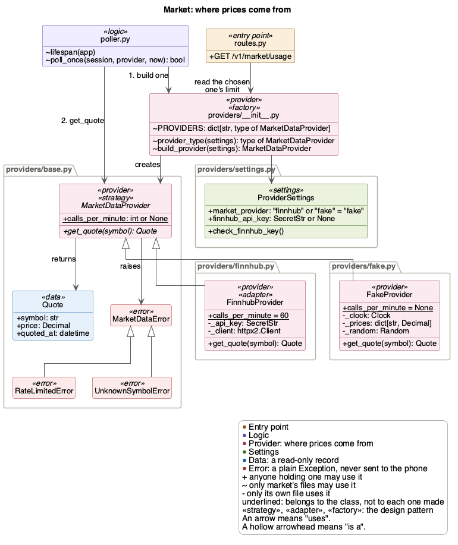
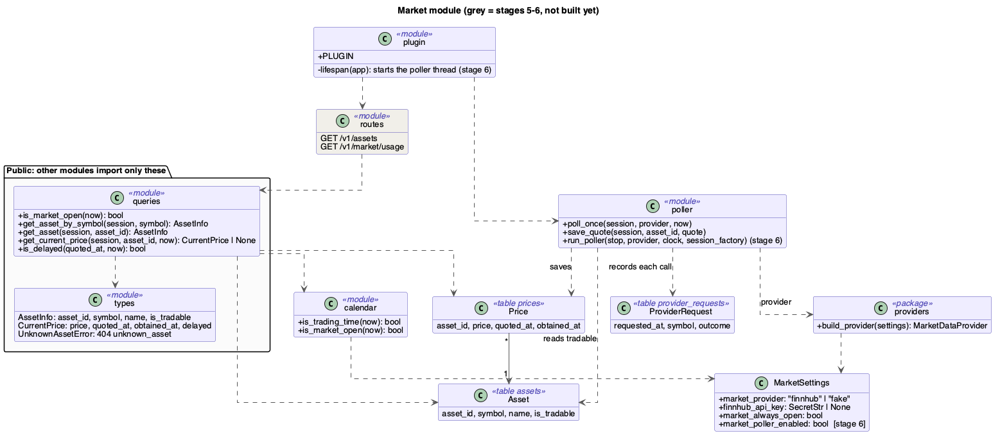
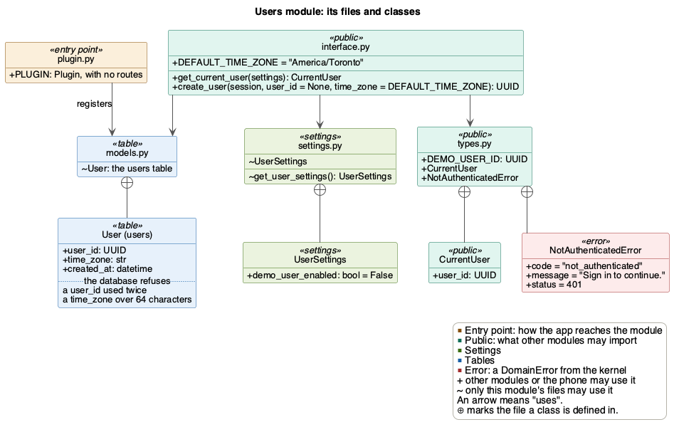
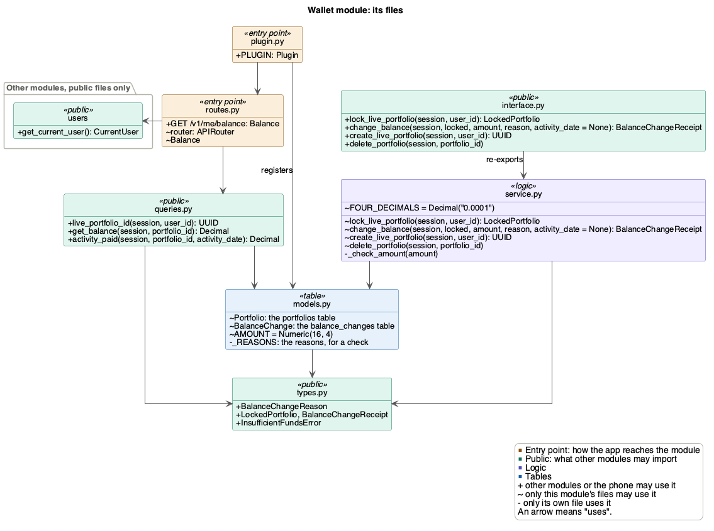
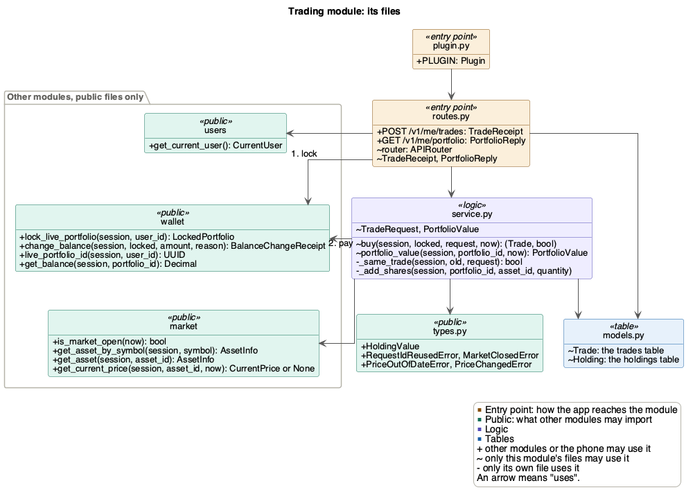

# FitFolio backend architecture

| Date | Version | Author | Notes |
|---|---|---|---|
| Nov 5, 2026 | 1.0 | Davis Lenover | PoC version |
| Nov 7, 2026 | 1.1 | Davis Lenover | Module health, users and wallet |
| Nov 8, 2026 | 1.2 | Davis Lenover | Trading |

This covers only what the PoC needs. It grows as features are added.

## Architecture

**Client–server.** The phone app is the client. It talks to one backend server
over HTTPS, sending and receiving JSON (a REST API).

**The server is a modular monolith on a small kernel.** It is one FastAPI
process with one PostgreSQL database, split into modules.
- **Modules:** one per feature. Each is a folder in `src/backend/app/` and
  owns its own tables.
- **Layers:** modules are stacked, and calls only go down. Trading calls
  market, but market never calls trading.
- **Public interfaces:** other modules use a module only through its public
  files.
- **Kernel:** `app/core/` holds what every module shares, and never imports a
  module.
- **Plug-ins:** each module adds its routes to the app through its
  `plugin.py`, which is listed in `app/registry.py`.
- **Adapter:** market gets prices through a provider class, so Finnhub can be
  swapped for another provider without changing other modules.

The server isn't split into separate services, because a buy must change the
balance and the shares in one database transaction (FR_MktAtomicTrade). CI
rejects any import that breaks these rules.


The rows inside "Modules" show the stacking. Trading uses market and wallet,
activity uses wallet, and wallet uses users. Every module with routes also uses users to
get the current user.

The diagram's source is `figures/backend-poc.puml`. After changing it, run
this from the repository root to update the PNG:

```bash
plantuml -tpng docs/Design/SoftArchitecture/figures/backend-poc.puml
```

## A module's files

| File | What it holds | Other modules may import it |
|---|---|---|
| `interface.py` | Functions other modules may call | Yes |
| `queries.py` | Reads other modules may call. They never write | Yes |
| `types.py` | Data classes and errors | Yes |
| `service.py` | The rules. Never commits | No |
| `models.py` | The tables | No |
| `routes.py` | HTTP routes. Commits once | No |
| `plugin.py` | Adds the module to the app: its routes, background work and health check | No, only `app/registry.py` |

Leave out any file a module doesn't need. Each module's pull request also adds
or updates the module's UML class diagram, `figures/<module>.puml`, and the PNG
made from it.

## Rules

1. Import another module only through its `interface.py`, `queries.py` or
   `types.py`.
2. Never import a module above yours in the diagram.
3. Never use another module's tables. A foreign key into them is fine, such
   as `trades.asset_id` to `assets`.
4. Only routes commit, once per request. Market's poller thread is the one
   exception: it commits once per poll.
5. Money only moves through wallet. Lock the portfolio with
   `wallet.interface.lock_live_portfolio()` before calling `change_balance`,
   as [Users and wallet](#users-and-wallet-who-is-calling-and-how-money-changes)
   shows.
6. Take the time from `app/core/clock.py`, never from `datetime.now()`, so
   tests can set it.

## Design patterns

Five patterns, each used where it solves a real problem.

**Plug-in kernel.** The kernel (`app/core/` and `create_app()`) doesn't know
which modules exist. Each module fills in a `Plugin` in its `plugin.py`, with
its routes, any work that runs in the background, and a health check, and
`app/registry.py` lists them. Adding a module never changes the kernel.
`GET /v1/health` shows each module's health check. A health check is
optional, but a module with background work must have one, since that work
can fail without any request seeing it. `Plugin` refuses one without it.


**Strategy, adapter and factory.** Market asks for prices through one
interface, `MarketDataProvider`. `FinnhubProvider` adapts Finnhub's API to
it, `FakeProvider` makes up prices, and `build_provider` picks one from
`MARKET_PROVIDER`. See [Market](#market-where-prices-come-from) for the
diagram.

**Dependency injection.** Code is handed what it needs instead of fetching
it. Routes get a database session and the clock from the kernel, through
`Depends(get_db)` and `Depends(get_clock)`, and the current user from users,
through `Depends(get_current_user)`. The poller is given its provider,
clock and session factory. Tests hand in stand-ins, such as a fixed time or a
stub provider.

**Read-only records.** A module hands other modules frozen copies, such as
`AssetInfo` and `CurrentPrice` in `app/market/types.py` or wallet's
`BalanceChangeReceipt`, never database rows. That way no module can change
another module's tables by accident.

**Lock token.** Wallet's `change_balance` only takes the `LockedPortfolio`
that `lock_live_portfolio` returns, so changing a balance without locking it
first is hard to do by accident. See
[Users and wallet](#users-and-wallet-who-is-calling-and-how-money-changes).

## How it runs

When the app starts, the kernel adds each module's routes and starts each
module's background work. For market, that is the poller thread, which saves
a price for every stock once a minute while the market is open.


A request goes from the kernel to the module's route, which reads through the
module's queries.


## What the PoC builds

| Folder | Owns these tables | Routes | Issue |
|---|---|---|---|
| `app/core/`, `app/registry.py`, `app/main.py` | none | `GET /v1/health` | #187, first pull request |
| `app/market/` | `assets`, `prices`, `provider_requests` | `GET /v1/assets`, `GET /v1/market/usage` | #187 |
| `app/users/` | `users` | none (it provides the current user) | #279 |
| `app/wallet/` | `portfolios`, `balance_changes` | `GET /v1/me/balance` (#189) | #279 |
| `app/activity/` | `activity_daily_totals` | `PUT /v1/me/activity/daily-totals` | #190 |
| `app/trading/` | `trades`, `holdings` | `POST /v1/me/trades`, `GET /v1/me/portfolio` | #188 |

#187's first pull request sets up the shared pieces. It moves `Money` from
`app/api/` into `app/core/`, and the health route into `app/core/routes.py`.
It adds `app/core/clock.py` and `app/registry.py`, the list of modules. It also
adds `create_app()` in `app/main.py`, which adds each module's routes, and
`app = create_app()` keeps `uv run uvicorn app.main:app` working. The price
poller is market's own background thread, which market's plugin starts and
stops with the app.



#191 adds two checks to CI:
- an import-linter rule: no module imports one above it, and `app/core/`
  imports no module
- a test: modules import each other only through their public files

## Market: where prices come from

Market gets prices through one interface, `MarketDataProvider`, so the rest
of the module never knows which provider it is using.



- **Strategy:** `MarketDataProvider` has one method, `get_quote(symbol)`,
  which returns a `Quote`: the symbol, the price and when it was quoted.
- **Adapter:** `FinnhubProvider` turns Finnhub's HTTP API into a `Quote`, and
  its errors into ours, such as `RateLimitedError`.
- **Fake:** `FakeProvider` makes up prices, for development and tests.
- **Factory:** `build_provider(settings)` picks one from `MARKET_PROVIDER`.
  The poller is given that provider and only calls `get_quote`.
- **Errors:** every provider reports a problem as `MarketDataError` or one of
  its subclasses, so the poller can record what happened without knowing
  which provider it has.

To add a provider:
1. Write a class in `app/market/providers/` that names `MarketDataProvider` as
   its base and has `get_quote(symbol)`.
2. Add its name to `MARKET_PROVIDER` in `app/market/providers/settings.py` and to
   `.env.example`.
3. Add it to `build_provider`.

The whole market module, with the parts still to come in grey:



## Users and wallet: who is calling, and how money changes

**Users.** `users.interface.get_current_user` is the one place that knows who
is calling. A route that needs a user asks for it with
`Depends(get_current_user)`, so the phone never sends a user ID. The PoC has
no sign-in. While `DEMO_USER_ENABLED` is on, every request is the demo user,
whose ID is `DEMO_USER_ID` in `app/users/types.py`. While it is off, as it is
by default, the route answers 401 `not_authenticated`. Real sign-in later
only changes the inside of this function.

`get_current_user` doesn't check that the user exists. The demo user and its
live portfolio have to be made first, with `create_user(db, DEMO_USER_ID)` and
`create_live_portfolio(db, DEMO_USER_ID)`, which
`uv run python -m app.scripts.seed_demo` does. Until then, wallet's functions
fail for the demo user.



**Wallet.** Each portfolio's currency lives in wallet, and only wallet changes
it. A route that changes money does three things:

```python
from app.wallet.interface import change_balance, lock_live_portfolio
from app.wallet.types import BalanceChangeReason

locked = lock_live_portfolio(db, user.user_id)
receipt = change_balance(db, locked, -cost, BalanceChangeReason.TRADE_PURCHASE)
db.commit()
```

1. **Lock first.** `lock_live_portfolio` locks the portfolio's row until the
   transaction ends. Two requests for one portfolio, such as a buy and a step
   sync, then run one after the other, and the second sees what the first
   saved. That only holds for what the route reads after the lock, so read
   anything the amount depends on there, such as what a day's rewards have
   paid so far (`wallet.queries.activity_paid`).
2. **Change with one guarded `UPDATE`.** `change_balance` adds the amount only
   if the balance stays at 0 or more, then records the change in
   `balance_changes`. If the balance would go below 0, it raises
   `InsufficientFundsError` (409) and changes nothing. It never commits.
3. **Commit once.** The route commits after every step has succeeded, so the
   payment and what it pays for are saved together or not at all.

`change_balance` also refuses, with `ValueError` and before changing anything,
a call that makes no sense:
- an amount that is 0, isn't a finite `Decimal`, or has more than 4 decimals.
  So when a reward comes to 0, don't call it
- a reward that takes currency away, or a purchase that adds it
- a reward without its `activity_date` (the `date` it pays for), or anything
  else with one

The database also refuses bad rows, even from code that skips wallet's
functions: a balance below 0, a second live portfolio for a user, a change of
0, a reward that spends or a purchase that adds, and a reward without a day or
anything else with one. It deletes a portfolio's changes with it. It doesn't
check that a balance equals the sum of its changes (SEC-22). `change_balance`
keeps that true by changing both in one transaction, which is why nothing
else may change a balance.

Two of the patterns above keep this safe:
- **Read-only records:** `change_balance` returns a `BalanceChangeReceipt`
  (the change's ID, its amount and the balance after it), never the row.
  Trading will store the receipt's ID with its trade (#188).
- **Lock token:** `change_balance` asks for the `LockedPortfolio` that
  `lock_live_portfolio` returns. Nothing stops code making one itself, but
  asking for it makes skipping the lock hard to do by accident. If the lock is
  skipped anyway, the guarded `UPDATE` still keeps the balance at 0 or more.



## Trading: buying shares

Trading buys whole shares with a portfolio's currency, and values the
portfolio at the latest prices. The PoC only buys.

`POST /v1/me/trades` follows wallet's three steps:
1. The route locks the portfolio with `lock_live_portfolio`.
2. `buy` checks the request, pays with `change_balance`, adds the shares to
   `holdings` and saves the trade. It never commits.
3. The route commits once, so the payment, the shares and the trade are saved
   together or not at all.

**One trade per `request_id` (an idempotency key).** The phone sends a new
`request_id` for each buy the user confirms, and the same one again when it
retries. A repeat gets the first trade back (200 instead of 201) and pays
nothing. The same `request_id` with a different symbol, quantity or price is
refused. The database also refuses a second trade with one `request_id` in a
portfolio.

**Only at the price the user saw (SEC-29).** The phone sends back
`expected_price` exactly as `GET /v1/assets` gave it. `buy` reads the price
once, and uses that one read for the check, the trade's price and the cost.

`buy` refuses, in this order:

| Code | Status | When |
|---|---|---|
| `request_id_reused` | 409 | The `request_id` was used for a different trade |
| `market_closed` | 409 | The market is closed |
| `unknown_asset` | 404 | No stock has that symbol |
| `price_out_of_date` | 409 | The stock has no price yet, or it is delayed |
| `price_changed` | 409 | The price isn't `expected_price`. The message gives the new one |
| `insufficient_funds` | 409 | The balance is less than the cost. Wallet refuses this one |

`GET /v1/me/portfolio` values each holding at its quantity × its latest price,
and flags a delayed price. It only reads, so it doesn't lock or commit.

Besides the idempotency key, trading uses the patterns above: the plug-in
kernel, dependency injection, read-only records and wallet's lock token.



## Migrations

There is still one chain, and 0001 to 0003 don't change. Name each new
migration after its module:

```bash
uv run alembic revision --autogenerate --rev-id market_0001 -m "provider requests"
```

If `main` gets a new migration while you work, set your migration's
`down_revision` to it before you merge. The backend README shows how.
