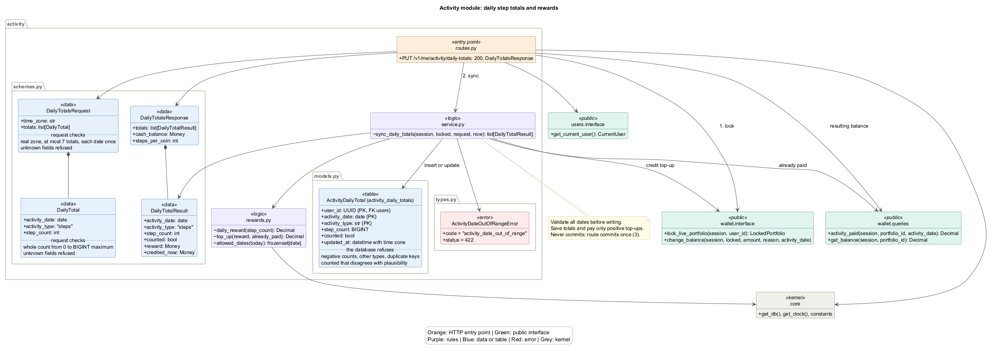

# Activity module

Activity saves daily step totals from the phone and turns them into virtual
currency. The phone sends a total for a date, not an increment to add.

| | |
|---|---|
| Folder | `src/backend/app/activity/` |
| Table | `activity_daily_totals` |
| Route | `PUT /v1/me/activity/daily-totals` |
| Uses | [users](users.md), [wallet](wallet.md) |
| Used by | Nothing yet |
| Issue | [#190](https://github.com/davislenover/BurnNEarn/issues/190) |

## Files



`rewards.py` holds the reward calculations without using a database.
`schemas.py` defines the request and reply. `service.py` saves the totals and
asks wallet to pay what is still owed. It never commits. `routes.py` locks the portfolio
first and commits once at the end. `plugin.py` adds the route and registers
the table through `app/registry.py`.

Nothing calls activity from another module yet, so it needs no `interface.py`
or `queries.py`.

## Sending totals

The request has the phone's time zone and up to seven daily totals:

```json
{
  "time_zone": "America/Toronto",
  "totals": [
    {
      "activity_date": "2026-11-12",
      "activity_type": "steps",
      "step_count": 8421
    }
  ]
}
```

The server gets the user from `get_current_user`. The phone cannot name a
user or set `counted`, a reward, or a balance. Unknown fields are refused at
both levels. Each date may appear only once, and only `steps` is supported.
Counts must be whole numbers from 0 to 9,223,372,036,854,775,807, the largest
value the table's `BIGINT` column can store. Strings, floats and booleans are
refused rather than converted into counts.

The time zone must exist, such as `America/Toronto`. The server converts its
injected clock to that zone to find today, then accepts today and the six
dates before it. It checks every date before saving any total. A future or
older date refuses the whole batch with 422 and
`detail.code = "activity_date_out_of_range"`. Other malformed requests get
the app's existing 422 validation response. An unauthenticated request gets
401.

A successful request returns **200 OK**, with each submitted day's result
in request order, the balance after all top-ups, and the earning rate:

```json
{
  "totals": [
    {
      "activity_date": "2026-11-12",
      "activity_type": "steps",
      "step_count": 8421,
      "counted": true,
      "reward": "84.0000",
      "credited_now": "84.0000"
    }
  ],
  "cash_balance": "84.0000",
  "steps_per_coin": 100
}
```

`reward` is what the submitted count earns for that day. `credited_now` is
the amount this request actually added after subtracting previous payments.
A repeat still reports the daily reward, but credits zero. An empty list
returns `totals: []` and the unchanged balance. Money is sent as text with
four decimals, following the existing wallet API.

`steps_per_coin` is the number of steps that earns one coin, currently 100.
It comes from `EARNING_RATES[ActivityType.STEPS]`, the same constant used by
the reward calculation. It is included even for an empty list or a repeat,
so the phone can show the current rate without hard-coding it.

The frontend's `sendTodaysSteps` checks and returns this reply.
`useTodaySteps` exposes it as `syncResult`, clears it when a new read starts,
and keeps read errors separate from sync errors. The phone can read the rate
from `syncResult.steps_per_coin` after a successful sync.

## Rewards and repeat syncs

`daily_reward` uses the constants in `app/core/constants.py`:

- Every 100 steps earns one whole unit of currency.
- Each day's reward stops at 300 (FR_ActDailyCap).
- More than 150,000 steps earns zero and is stored with `counted=false`
  (FR_ActPlausible). Exactly 150,000 is still counted.

For each date, `activity_paid` reads how much wallet has already paid.
`top_up` subtracts that from the new reward, with a minimum of zero. Currency
uses exact `Decimal` values throughout.

| Total sent for the same date | Daily reward | Credited now | Paid so far |
|---|---|---|---|
| 8,421 | 84 | 84 | 84 |
| 8,421 again | 84 | 0 | 84 |
| 8,500 | 85 | 1 | 85 |
| 8,000 | 80 | 0 | 85 |
| 200,000 | 0 | 0 | 85 |
| 8,600 | 86 | 1 | 86 |

Each sync replaces the stored count and `counted` flag, including when a
total falls. It never takes back currency that has already been paid.
`counted` means the total passes the plausibility check; a valid zero-step
day is counted even though it earns nothing.

## One transaction

The route follows [wallet's three steps](wallet.md#changing-a-balance):

1. Lock the user's live portfolio with `lock_live_portfolio`.
2. Save each total, read that date's payments, and call `change_balance`
   only for a positive top-up, with reason `activity_reward` and its date.
3. Build the reply with the resulting balance, then commit once, saving all
   totals and payments together. The reply contains plain values, so sending
   it after the commit cannot reload a newer balance from another request.

A second request for the same portfolio waits for that lock. When it
continues, it sees the preceding request's payments, so it cannot pay a day
twice. A failure anywhere in the batch rolls back every total and payment
from that request. Activity never changes wallet's tables directly.

## Table and migration

`activity_daily_totals` has a composite primary key of `user_id`,
`activity_date` and `activity_type`. Sync inserts a row or updates that key's
existing row. `updated_at` comes from the injected clock and is stored with
its time zone.

The database also refuses negative counts, types other than `steps`, and a
`counted` flag that disagrees with the plausibility limit. The user must
exist, and deleting that user also deletes their totals. Migration
`activity_0001` follows `market_0002` and can undo the new table.

## PoC limits

The server trusts the phone's step count and supplied time zone; the
plausibility check is not proof that the activity happened. Other activity
types, health-data consent stored on the server, trends, streaks and a
read API for totals are outside #190. The phone currently handles the health
notice before reading or syncing steps.

## Tests

| File | What it checks |
|---|---|
| `test_activity_rewards.py` | Reward boundaries, exact top-ups and the seven allowed dates |
| `test_activity_routes.py` | Request validation, date boundaries, payments, retries, user isolation, rollback, and a persisted demo-user week |
| `test_activity_service.py` | The service never commits, and its changes can be rolled back |
| `test_activity_tables.py` | PostgreSQL's constraints, unique key and user deletion |
| `test_activity_concurrency.py` | A real portfolio lock wait and one payment for concurrent HTTP syncs |

To check a week through `/docs`, seed the demo user and enable demo mode as
described in the backend README. Submit seven distinct dates in the current
allowed week, each with 8,421 steps. A previously unpaid week adds 588
currency. Sending it again adds zero. Check the reply's `cash_balance` and
each day's `credited_now` to see the result.
