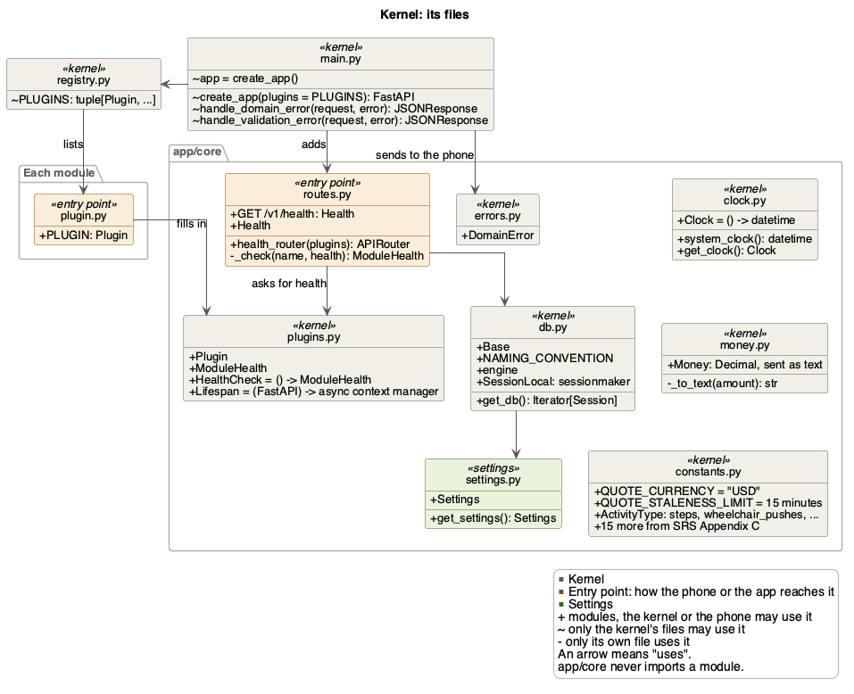
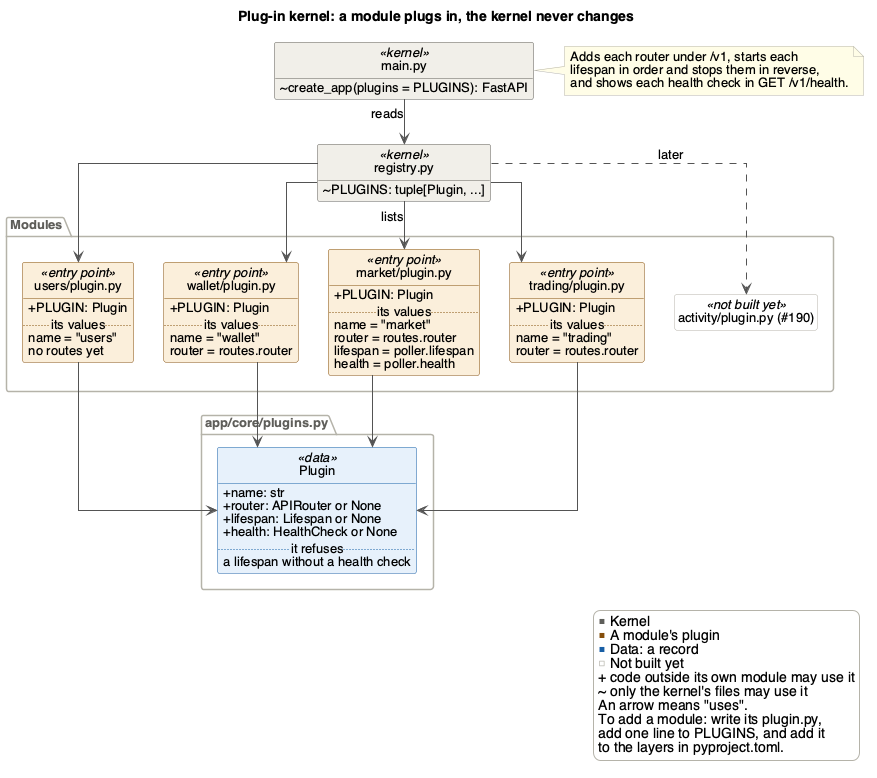
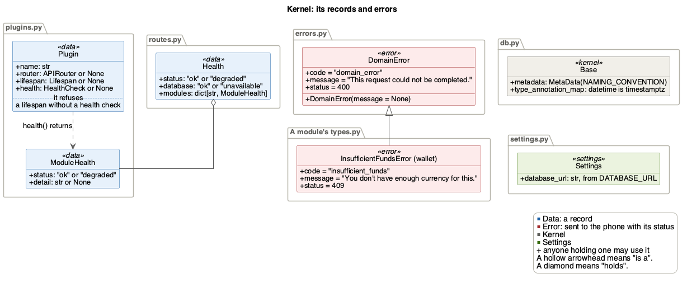

# Kernel (app/core)

The kernel holds what every module shares, and builds the app from the
modules' plugins. `app/core/` never imports a module.

| | |
|---|---|
| Folder | `src/backend/app/core/`, plus `app/main.py` and `app/registry.py` |
| Tables | None |
| Routes | `GET /v1/health` |
| Uses | No module |
| Used by | Every module: [users](users.md), [wallet](wallet.md), [market](market.md), [trading](trading.md) |
| Issue | #187, #191 |

## Files



Every module may import any file in `app/core/`, so its names are `+`, or
`-` if they start with `_`. `main.py` and `registry.py` sit above every
module, so no module may import them, and their names are `~`.

## How a module plugs in



The kernel doesn't know which modules exist. Each module fills in a `Plugin`
in its `plugin.py`, with its routes, any work that runs while the app runs (a
lifespan, such as market's poller thread) and a health check.

`registry.py` lists each module's `PLUGIN` in `PLUGINS`. A `plugin.py`
imports its module's `models.py`, even with no routes, so importing the
registry registers every module's tables. That is how Alembic finds them.

`create_app(plugins = PLUGINS)` in `main.py` builds the app:
- It adds the health route and each module's routes under `/v1`.
- When the app starts, it starts each lifespan in the order of `PLUGINS`. An
  exit stack stops them in reverse order when the app stops, even if one
  fails to start. A lifespan stops its work in a `finally` after its `yield`,
  so the work stops even when a later module fails to start.
- It adds the two error handlers [below](#how-a-refusal-reaches-the-phone).

`app = create_app()` is what `uv run uvicorn app.main:app` serves. Tests pass
their own plugins to build a smaller app.

To add a module, write its `plugin.py` (importing its `models.py`), add one
line to `PLUGINS`, and add the module to the layers in `pyproject.toml` so
import-linter checks it. Nothing in `app/core/` or `create_app` changes.

## Module health

`GET /v1/health` needs no user. It tells the team and CI whether the API can
reach the database, and how each module with a health check is doing:

```json
{"status": "ok", "database": "ok", "modules": {"market": {"status": "ok", "detail": null}}}
```

| The database | The modules | Status | `status` |
|---|---|---|---|
| Reachable | All `ok` | 200 | `ok` |
| Reachable | One is `degraded` | 200 | `degraded` |
| Unreachable | Any | 503 | `degraded` |

Nothing works without the database. A degraded module still gets 200, since
the rest of the API still works.
- A module without a health check is left out. In the PoC only market has
  one, for its poller.
- A health check reads only what its module keeps in memory, with no
  database or network call, so it answers at once.
- `detail` is a short fixed text, such as `poller stopped`, never a secret or
  an error's own text.
- A check that raises, or returns something other than a `ModuleHealth`, is
  shown as `degraded` with the detail `health check failed`. Its error goes to
  the log only, since its text could say too much.
- A module with a lifespan must have a health check, since background work
  can fail without any request seeing it. `Plugin` refuses one without it.

## How a refusal reaches the phone

A module refuses a request by raising a subclass of `DomainError`, which sets
its `code`, `message` and `status`:

```python
class InsufficientFundsError(DomainError):
    code = "insufficient_funds"
    message = "You don't have enough currency for this."
    status = 409
```

`handle_domain_error` in `main.py` sends any of them in one shape, with its
status:

```json
{"detail": {"code": "insufficient_funds", "message": "You don't have enough currency for this."}}
```

A message can be set when the error is raised, such as trading's
`price_changed` giving the new price. The class's own message doesn't change.
The PoC's refusals are users' `not_authenticated` (401), market's
`unknown_asset` (404), wallet's `insufficient_funds` (409) and trading's
four (409).

A request that doesn't fit its route, such as an amount with more than 4
decimals, gets 422 in FastAPI's shape, but `handle_validation_error` leaves
out the values that were sent (`input`). FastAPI's own handler sends each one
back, and some can't be written as JSON, such as `NaN` in a body, so the
phone would get a 500.

```json
{"detail": [{"type": "decimal_max_places", "loc": ["body", "expected_price"],
  "msg": "Decimal input should have no more than 4 decimal places",
  "ctx": {"decimal_places": 4}}]}
```

## Money

`Money` is the type for amounts the API sends or takes. Python code gets a
`Decimal`. JSON gets text with 4 decimals, such as `"84.0000"`, because JSON
numbers can lose exactness on the way (NFR_Accuracy). A zero is always
`"0.0000"`, never `"-0.0000"`. A reply's `Money` shows as text in the API
docs. A request may send a number or text.

An amount with more than 4 decimals is refused, not rounded. A request with
one gets a 422, as above. Code that builds a reply rounds an amount from a
division or `avg()` first, with `.quantize(Decimal("0.0001"))`.

## The clock

Code takes the time from a `Clock`, a function that returns the current time
with its time zone, never from `datetime.now()`
([rule 6](../BackendArchitecture.md#rules)). `system_clock` gives the real
time in UTC.
- A route asks for it with `Depends(get_clock)`.
- A test sets the time with `app.dependency_overrides[get_clock]`, as the
  `at_time` fixture does.
- Market's poller and `FakeProvider` are handed a clock, `system_clock` by
  default.

## The database

`db.py` builds the engine from `DATABASE_URL` when it is first imported. Tests
point it at a database ending in `_test` before that.
- `get_db` gives each request its own session, through `Depends(get_db)`. The
  session closes when the request ends, which drops whatever the route didn't
  commit. Only routes commit, once per request
  ([rule 4](../BackendArchitecture.md#rules)).
- `SessionLocal` makes a session outside a request, such as for each of
  market's polls and for `seed_demo`.
- `Base` is every table's base class. Alembic reads its metadata.
- `NAMING_CONVENTION` gives each index and constraint a name you can predict,
  such as `uq_prices_asset_id_quoted_at`, so a migration can refer to it.
- Every `datetime` column is stored with its time zone (`timestamptz`), so
  times from users and the server compare correctly.

## Settings and constants

`Settings` reads `DATABASE_URL` from the environment or a local `.env`, once
per process (`get_settings`). Without one, it uses the local compose
database (`fitfolio` on localhost:5432). Each module reads its own settings
in its own `settings.py`, such as users' `DEMO_USER_ENABLED`. Migrations read
the same `DATABASE_URL`. A password with characters like `@` is written with
`%` in a URL, which Alembic would misread, so `migrations/env.py` doubles
each `%`.

`constants.py` holds the SRS's symbolic constants (Appendix C). Change a value
there and in the SRS together. Market uses `QUOTE_CURRENCY` and
`QUOTE_STALENESS_LIMIT`. The rest wait for their features.

## Records and errors



`Plugin` and `ModuleHealth` are frozen, so nothing changes them once made.
`Health` is the reply of `GET /v1/health`.

## Design patterns

- **Plug-in kernel:** modules plug in through `Plugin` and `PLUGINS`, and
  the kernel doesn't change, as above.
- **Dependency injection:** routes get the session and the clock through
  `Depends(get_db)` and `Depends(get_clock)`, so tests hand in a test session
  or a fixed time.

## Tests

| File | What it checks |
|---|---|
| `test_create_app.py` | Routes under `/v1`, a lifespan without a health check refused, lifespans started in order and stopped in reverse, unique module names |
| `test_health.py` | `GET /v1/health`: 200 or 503, degraded modules, and a check that raises or returns the wrong thing, shown without its error |
| `test_errors.py` | A `DomainError`'s JSON and status, and a 422 without the values sent, even `NaN` |
| `test_money.py` | `Money` as text with 4 decimals, a `Decimal` in Python, more than 4 decimals refused |
| `test_clock.py` | The real clock is in UTC, and a test can set the time a route sees |
| `test_migrations.py` | One newest migration, and a database password with special characters |
| `test_public_files.py` | Modules import each other only through their public files, and only `registry.py` imports a `plugin.py` |
| `test_test_setup.py` | The shared test setup: a database ending in `_test`, each test's rows undone, a route keeps a row only if it commits, the real `get_db` |
