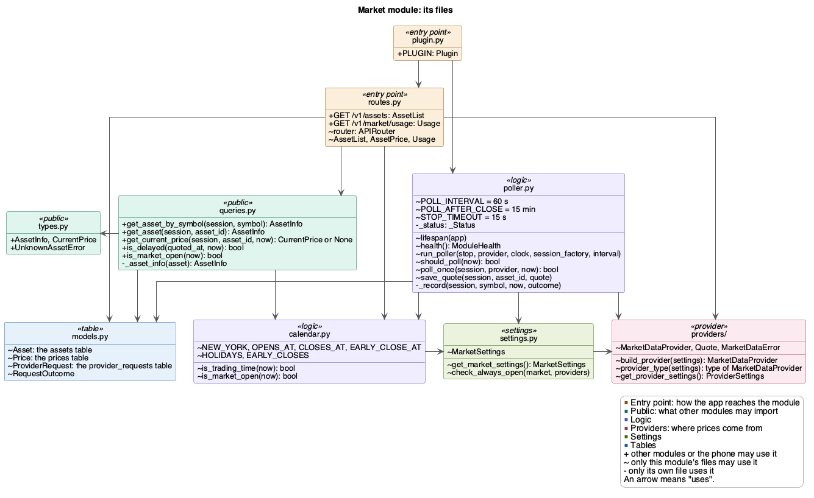
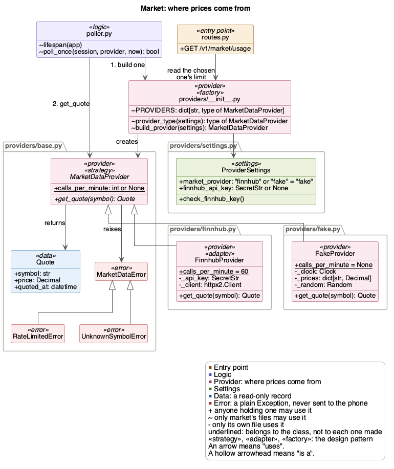
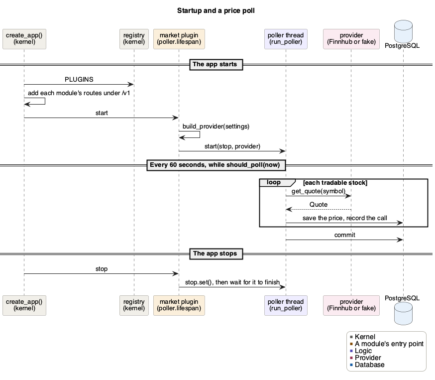
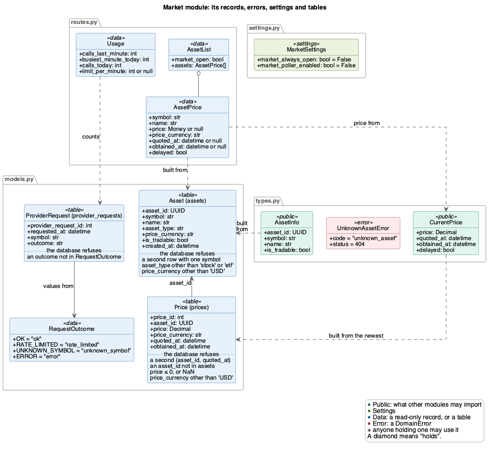

# Market module

Market keeps the stocks the app offers and their prices. A background thread
asks a market data provider for each stock's price once a minute while the
market is open, and for 15 minutes after it closes.

| | |
|---|---|
| Folder | `src/backend/app/market/` |
| Tables | `assets`, `prices`, `provider_requests` |
| Routes | `GET /v1/assets`, `GET /v1/market/usage` |
| Uses | Only [the kernel](core.md) |
| Used by | [trading](trading.md) |
| Issue | #187 |

## Files

Other modules read market only through `queries.py`, which never writes, and
`types.py`. The providers, the poller and the calendar are market's own.
`plugin.py` adds the routes, and starts and stops the poller with the app.

## Where prices come from

- **Strategy:** every provider has one method, `get_quote(symbol)`, which
  returns a `Quote`. The poller only calls `get_quote`, so it works the same
  with any provider.
- **Adapter:** `FinnhubProvider` turns Finnhub's quote API into a `Quote`,
  with exact `Decimal` prices. It turns Finnhub's problems into a
  `MarketDataError`, such as `RateLimitedError` for a 429 or
  `UnknownSymbolError` for a reply of zeros, so the poller records what
  happened without knowing the provider. These never reach the phone.
- **Fake:** `FakeProvider` makes up prices, for development and tests. Each
  symbol starts at the same price every run, from 20 to 500, moves by up to
  0.5% on each call, and is quoted at the current time.
- **Factory:** `build_provider(settings)` returns the provider that
  `MARKET_PROVIDER` names, `fake` by default. An unknown name is refused,
  never replaced by made-up prices, which would be shown as real.
  `provider_type(settings)` gives the chosen provider's class without making
  one, so its request limit can be read.

Each provider gives its own request limit, `calls_per_minute`:
`FinnhubProvider` 60, Finnhub's free plan, and `FakeProvider` `None`, since it
calls no one. So a new provider brings its own limit, and no code outside
`providers/` changes.

**The Finnhub key stays on the server (SEC-33).** It is `FINNHUB_API_KEY` in
the server's `.env`, which git ignores. `ProviderSettings` keeps it as a
`SecretStr`, so printing the settings hides it. `FinnhubProvider` sends it in
a header, never in the URL, so no logged URL or error shows it. No route sends
it, and `provider_requests` never stores it. Finnhub gets only the stock's
symbol (SEC-11).

To add a provider, without changing any code outside `providers/`:
1. Write a class in `app/market/providers/` that names `MarketDataProvider` as
   its base, with `get_quote(symbol)` and `calls_per_minute`. One without
   `get_quote` fails as soon as it is created.
2. Add its name to `MARKET_PROVIDER` in `providers/settings.py` and to
   `.env.example`.
3. Add it to `PROVIDERS` in `providers/__init__.py`, and to `build_provider`.

## The poller

`plugin.py` hands the kernel `poller.lifespan`, which runs the poller's thread
while the app runs.
- **Starting and stopping:** `lifespan` reads the settings first, so bad ones,
  such as `MARKET_PROVIDER=finnhub` without a key, stop the app from starting.
  It starts the thread only while `MARKET_POLLER_ENABLED` is on, which is off
  unless `.env` turns it on (`.env.example` does), and off in tests. When the
  app stops, it waits up to 15 seconds for the thread to finish.
- **When:** every 60 seconds while the market is open, and for 15 minutes
  after it closes, since Finnhub's closing price can arrive a few minutes late.
- **A poll:** `poll_once` asks for each tradable stock's price and saves it.
  One stock's error doesn't stop the others, but the provider's request limit
  stops the poll. Every call is saved in `provider_requests` with how it ended.
- **Saving a price:** once per stock and quote time. An exact repeat is
  skipped, and a corrected price replaces the old one. Each save has its own
  savepoint, so a price the database refuses undoes only itself.
- **Committing:** each poll has its own session and commits once, since it
  answers no request ([rule 4](../BackendArchitecture.md#rules)). An error is
  logged and the next poll tries again, so one bad minute never stops the
  thread.

A poll fails if it raises an error or misses any stock's price, so a provider
that is down, or a wrong key, shows up even though no request sees an error.
`health` reports it in `GET /v1/health`, under `modules.market`:

| `detail` | `status` | When |
|---|---|---|
| `poller off` | `ok` | `MARKET_POLLER_ENABLED` is off, or the app has stopped |
| `poller stopped` | `degraded` | The thread ended while the app still runs |
| `last poll failed` | `degraded` | The latest poll failed. It shows until the next poll, which may be the next trading day |
| none | `ok` | The thread runs and its latest poll, if any, saved every price |

## Market hours

`calendar.py` knows when the New York Stock Exchange is open: 9:30 to 16:00
New York time on weekdays, to 13:00 on the days in `EARLY_CLOSES`, and never
on the days in `HOLIDAYS`. Both list 2026 and 2027, so add the next year's
dates each December. A time is turned into New York time first, so daylight
saving time is handled, and a time without a zone is refused.

`is_trading_time(now)` gives the real hours. `is_market_open(now)` is what the
app uses: the real hours, or always open while `MARKET_ALWAYS_OPEN` is on, to
develop in the evening. That only works with `MARKET_PROVIDER=fake`. With a
real provider the app refuses to start, so real prices are never shown as live
while the market is closed.

## When a price is delayed

A price is `delayed` when the market is open and the provider set it more than
`QUOTE_STALENESS_LIMIT` (15 minutes, in `app/core/constants.py`) ago
(FR_MktPriceAge). It goes by `quoted_at`, when the provider set the price, not
`obtained_at`, when the server got it, so an old quote is delayed even if the
server only just got it. While the market is closed, no price is delayed,
since the last one stays the same until it opens.

[Trading](trading.md) refuses a buy at a delayed price, but still values a
holding at it.

## Routes

Neither route needs a user.

**`GET /v1/assets`** sends every tradable stock, sorted by symbol, with its
newest price and `delayed`, and whether the market is open
(FR_MktRealPrices, FR_MktPriceAge). A price is text with 4 decimals, such as
`"84.0000"`, in `USD`. Before a stock's first price, its price and both times
are null.

**`GET /v1/market/usage`** counts the server's calls to the provider, to
check they stay within its request limit (SC_MarketData). It gives the calls
in the last minute, in the busiest minute today and in all of today, a New
York calendar day. `limit_per_minute` is the chosen provider's limit, 60 for
Finnhub's free plan, or null for the fake provider, which has none. It reads
the settings through `Depends`, so a test can choose the provider. A poll
makes one call per tradable stock, so the 15 stocks take 15 a minute.

## Records, errors, settings and tables

A stock's rows in `prices` are its price history, and its newest price is the
one with the latest `quoted_at` (FR_MktRealPrices). Every price is in USD, and
`assets` and `prices` refuse any other currency (FR_MktOneCurrency, SEC-27).
The database sets `obtained_at` when it saves a price.

## Design patterns

- **Plug-in:** `plugin.py` adds market's routes, the poller's `lifespan` and
  its `health`. The kernel doesn't change.
- **Strategy, adapter and factory:** `MarketDataProvider`, `FinnhubProvider`
  and `build_provider` with `provider_type`, as above.
- **Dependency injection:** the routes get the session and the clock through
  `Depends`, and the usage route gets the provider settings too. `run_poller` is given its provider, clock and session factory,
  `FakeProvider` its clock and `FinnhubProvider` its HTTP client, so tests
  hand in stand-ins.
- **Read-only records:** `AssetInfo` and `CurrentPrice` are frozen copies,
  never rows.

## Not built in the PoC

- Most of the stocks. Migration `0002` adds 15, and FR_MktAssetCount asks for
  `MIN_TRADABLE_STOCKS` (50).
- Adding or removing a stock without a new release (FR_MktUpdateAssets), and
  selling every user's shares of a removed one (FR_MktRemovedHoldings).
  `assets.is_tradable` is there, but nothing changes it yet.
- Market scenarios, which replay past prices (FR_MktScenario).

## Tests

| File | What it checks |
|---|---|
| `test_market_calendar.py` | The exchange's hours, holidays and early closes, time zones, `MARKET_ALWAYS_OPEN` opening the market for other modules too, and the settings `check_always_open` allows |
| `test_market_providers.py` | `build_provider` and `provider_type`, each provider's request limit, the Finnhub key setting, a provider without `get_quote`, and the fake provider's prices |
| `test_finnhub.py` | The Finnhub adapter against a fake Finnhub: exact prices, the key kept out of the URL, and each error |
| `test_market_poller.py` | `poll_once`: a price for each tradable stock, failures, the request limit, repeats skipped and corrections saved, the call log |
| `test_market_poller_thread.py` | When it polls, each poll committing, the app starting and stopping the thread, the settings' defaults, bad settings, and `health` |
| `test_market_queries.py` | The queries: read-only copies, unknown stocks, stocks that are not tradable, the newest price, and when a price is delayed |
| `test_market_routes.py` | `GET /v1/assets`, and `GET /v1/market/usage` with the chosen provider's limit |
| `test_assets_table.py` | The 15 starting stocks, and the rows the `assets` table refuses |
| `test_prices_table.py` | Prices saved exactly with both times, the rows the `prices` table refuses, each quote once |
