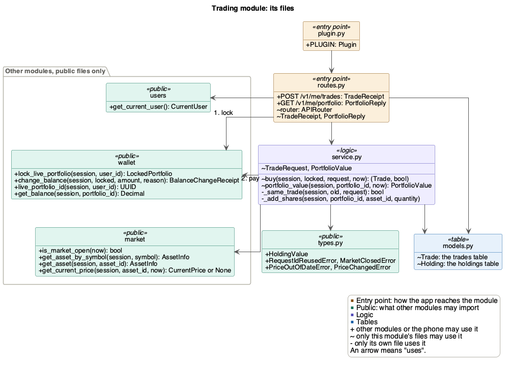
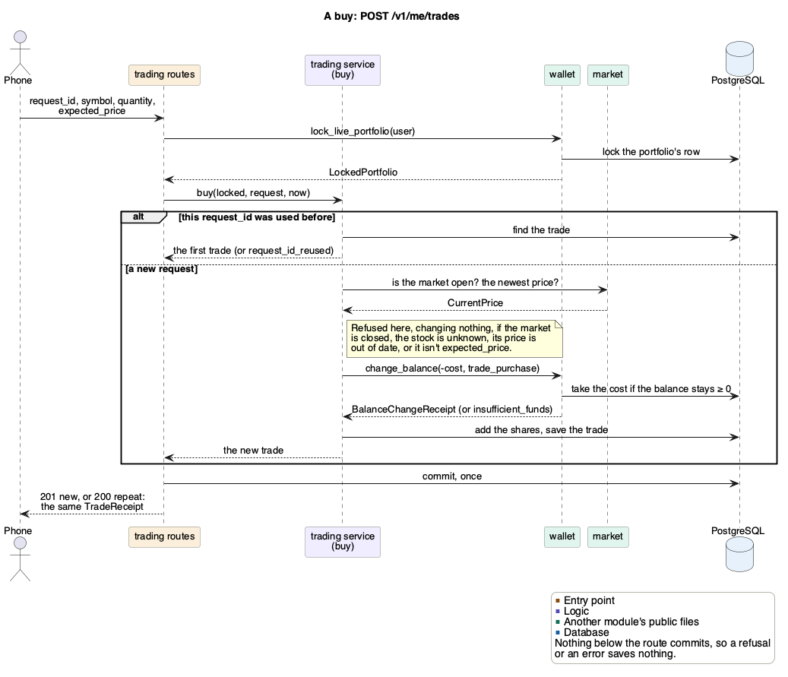
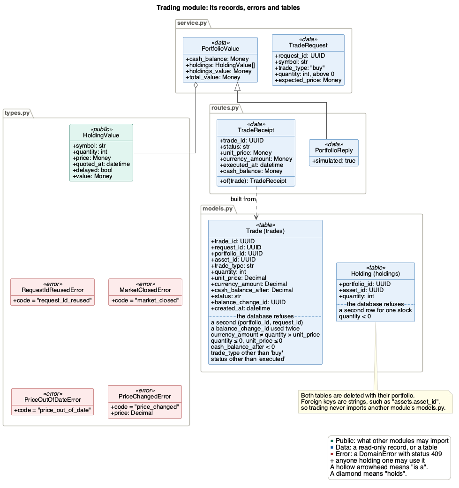

# Trading module

Trading buys whole shares with a portfolio's currency, and values the
portfolio at the latest prices. The PoC only buys.

| | |
|---|---|
| Folder | `src/backend/app/trading/` |
| Tables | `trades`, `holdings` |
| Routes | `POST /v1/me/trades`, `GET /v1/me/portfolio` |
| Uses | [users](users.md), [wallet](wallet.md), [market](market.md) |
| Used by | Nothing yet |
| Issue | #188 |

## Files

`routes.py` reaches the other modules only through their public files. It
locks the portfolio (1), and `buy` pays for the shares (2).

## Buying shares

`POST /v1/me/trades` follows [wallet's three steps](wallet.md#changing-a-balance):
1. The route locks the portfolio with `lock_live_portfolio`.
2. `buy` checks the request, pays with `change_balance`, adds the shares to
   `holdings` and saves the trade. It never commits.
3. The route commits once, so the payment, the shares and the trade are saved
   together or not at all (FR_MktAtomicTrade).

**One trade per `request_id` (an idempotency key).** The phone sends a new
`request_id` for each buy the user confirms, and the same one again when it
retries. A repeat gets the first trade back (200 instead of 201) and pays
nothing, even after the market closes or the price moves (FR_MktNoDuplicate).
The same `request_id` with a different symbol, quantity or price is refused.
The database also refuses a second trade with one `request_id` in a
portfolio.

**Only at the price the user saw (SEC-29).** The phone sends back
`expected_price` exactly as `GET /v1/assets` gave it. `buy` reads the price
once, and uses that one read for the check, the trade's price and the cost.

`buy` refuses, in this order:

| Code | Status | When |
|---|---|---|
| `request_id_reused` | 409 | The `request_id` was used for a different trade |
| `market_closed` | 409 | The market is closed |
| `unknown_asset` | 404 | No stock has that symbol. Market refuses this one |
| `price_out_of_date` | 409 | The stock has no price yet, or it is delayed |
| `price_changed` | 409 | The price isn't `expected_price`. The message gives the new one |
| `insufficient_funds` | 409 | The balance is less than the cost. Wallet refuses this one |

A refused buy saves nothing, so the same request can be sent again later.

What the phone must do:
- Send `expected_price` back as the text `GET /v1/assets` gave. A rounded
  number gets `price_changed` every time.
- Use a new `request_id` for each buy the user confirms, and the same one for
  each retry of it.

## What a portfolio is worth

`GET /v1/me/portfolio` sends each holding at its quantity × its stock's
latest price, sorted by symbol. A delayed price is still used, and its holding
is marked `delayed`.
- `holdings_value` is the sum of the holdings, the SRS's portfolio value
  (FR_MktPortfolioValue). It leaves the cash out.
- `total_value` is `cash_balance` + `holdings_value`.
- `simulated` is always true, so the phone labels the values as simulated
  (FR_MktLabelReturns).

It only reads, so it doesn't lock or commit. A buy that commits while it runs
can make one reply off by that buy. The next one is right.

## Records, errors and tables

The tables keep the money rules even for code that skips `buy`. For example,
a trade's cost must equal its quantity × its price, and one payment can only
pay for one trade.

## Design patterns

- **Plug-in:** `plugin.py` adds trading's routes to the app. The kernel
  doesn't change.
- **Dependency injection:** the routes get the session, the clock and the
  user through `Depends`, so tests set the time and the user.
- **Read-only records:** `HoldingValue` and `PortfolioValue` are frozen
  copies. Wallet hands trading a `BalanceChangeReceipt`, and market a
  `CurrentPrice`, never their rows.
- **Lock token:** `buy` only takes the `LockedPortfolio` that
  `lock_live_portfolio` returns.
- **Idempotency key:** `request_id`, as above.

## Not built in the PoC

- Selling, and queueing a buy for when the market opens (FR_MktQueueClosed).
  A buy while the market is closed is refused.
- Refusing a first trade before the user accepts the simulation notice
  (FR_MktSimNotice).

## Tests

| File | What it checks |
|---|---|
| `test_trading_request.py` | The request body and the four refusals |
| `test_trading_tables.py` | The rules the tables keep by themselves |
| `test_trading_buy.py` | `buy`: exact costs, every refusal and its order, each `request_id` once |
| `test_trading_routes.py` | `POST /v1/me/trades`: status codes, bodies, all or nothing |
| `test_trading_portfolio.py` | `portfolio_value` and `GET /v1/me/portfolio` |
