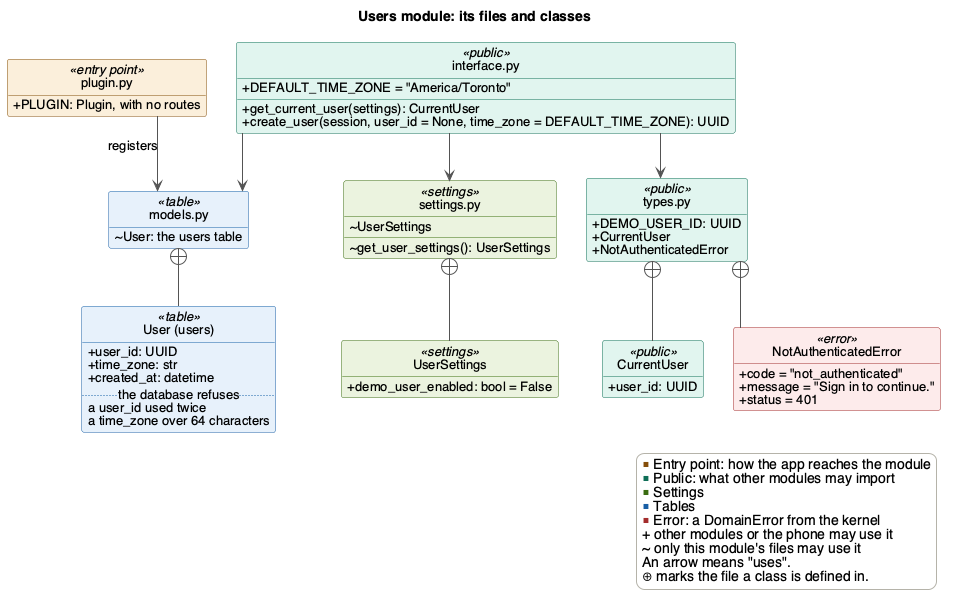

# Users module

Users knows who is calling. The PoC has no sign-in, so it has one built-in
demo user.

| | |
|---|---|
| Folder | `src/backend/app/users/` |
| Tables | `users` |
| Routes | None |
| Uses | Only [the kernel](core.md) |
| Used by | [wallet](wallet.md) and [trading](trading.md) routes, the seed script |
| Issue | #279 |

## Files



Other modules' routes use `get_current_user` and `CurrentUser`. The seed
script uses `create_user` and `DEMO_USER_ID`. `plugin.py` has no routes yet.
It only adds the `users` table to the app.

## Who is calling

`get_current_user` is the one place that knows who is calling. A route that
needs a user asks for one with `Depends(get_current_user)`, so the phone never
sends a user ID.

The PoC has no sign-in:
- While `DEMO_USER_ENABLED` is on, every request is the demo user, whose ID
  is `DEMO_USER_ID`. The ID is fixed, so the seed script and
  `get_current_user` always agree on who it is.
- While it is off, as it is by default, a route that needs a user answers 401
  `not_authenticated` ("Sign in to continue."). A server without the setting
  never runs as the demo user by accident.

`DEMO_USER_ENABLED` is read from the environment or `.env`, once per process.
`.env.example` turns it on, and `src/backend/README.md` has developers copy it
to `.env`, so a development server runs as the demo user.

Real sign-in later only changes the inside of `get_current_user`. The routes
keep asking for the user the same way.

## The demo user must exist first

`get_current_user` doesn't check that the user exists. The demo user and its
live portfolio have to be made first, or wallet's functions fail for it. The
seed script does both, with `create_user(session, DEMO_USER_ID)` and
`create_live_portfolio(session, DEMO_USER_ID)`. Run it from `src/backend`:

```bash
uv run python -m app.scripts.seed_demo
uv run python -m app.scripts.seed_demo reset
```

- Without `reset`, it adds whichever of the two is missing. Running it again
  changes nothing.
- With `reset`, it gives the demo user a new live portfolio at 0. The old one
  is deleted with everything under it, such as its balance changes and
  trades.

It uses only users' and wallet's public files, never their tables.

## Adding a user

`create_user(session, user_id = None, time_zone = DEFAULT_TIME_ZONE)` adds a
user and returns their ID. It flushes but never commits.
- Without a `user_id`, the database makes one. The flush is what lets it
  return that ID.
- A `user_id` that is already used fails at once, with `IntegrityError`. So
  the seed script adds the demo user in a savepoint, which undoes only that
  insert when the demo user already exists, such as after a failed run.
- It refuses a time zone that doesn't exist with `ValueError`, before adding
  anything, so a stored zone always works. The `users` table doesn't check
  it.
- Nothing reads the stored zone yet. Activity (#190) counts each day in the
  zone the phone sends with each sync, since a day follows where the user is
  (SEC-23).
- The default, `DEFAULT_TIME_ZONE`, is `America/Toronto`, since the team and
  its first users are in Ontario.

## Design patterns

- **Plug-in:** `plugin.py` adds users to the app, with no routes. The kernel
  doesn't change.
- **Dependency injection:** routes get the user through
  `Depends(get_current_user)`, and it gets its settings through
  `Depends(get_user_settings)`. Tests replace either in
  `app.dependency_overrides`, to pick the user or turn the demo user on.
- **Read-only records:** other modules get a frozen `CurrentUser`, never the
  `users` row.

## Not built in the PoC

- Sign-in and accounts (FR_AcctCreate, FR_AcctSignIn). They bring users'
  routes, and the sign-in fields of the `users` table, such as the email
  address.

## Tests

| File | What it checks |
|---|---|
| `test_users.py` | The demo user when it is on, that it is off by default, `create_user` with its time zone check, and the table refusing a user with no time zone |
| `test_seed_demo.py` | The seed script: the demo user with a portfolio at 0, running it twice, a user with no portfolio, and `reset` |
