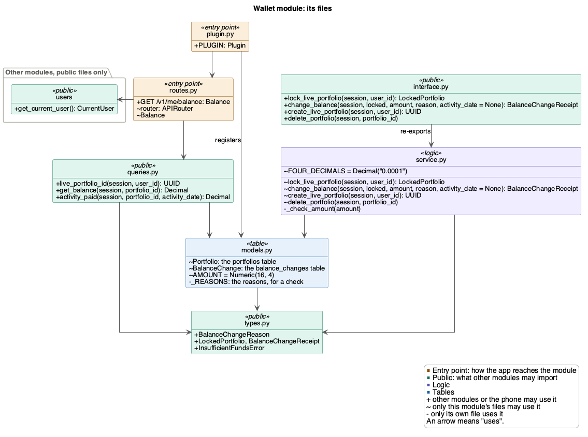
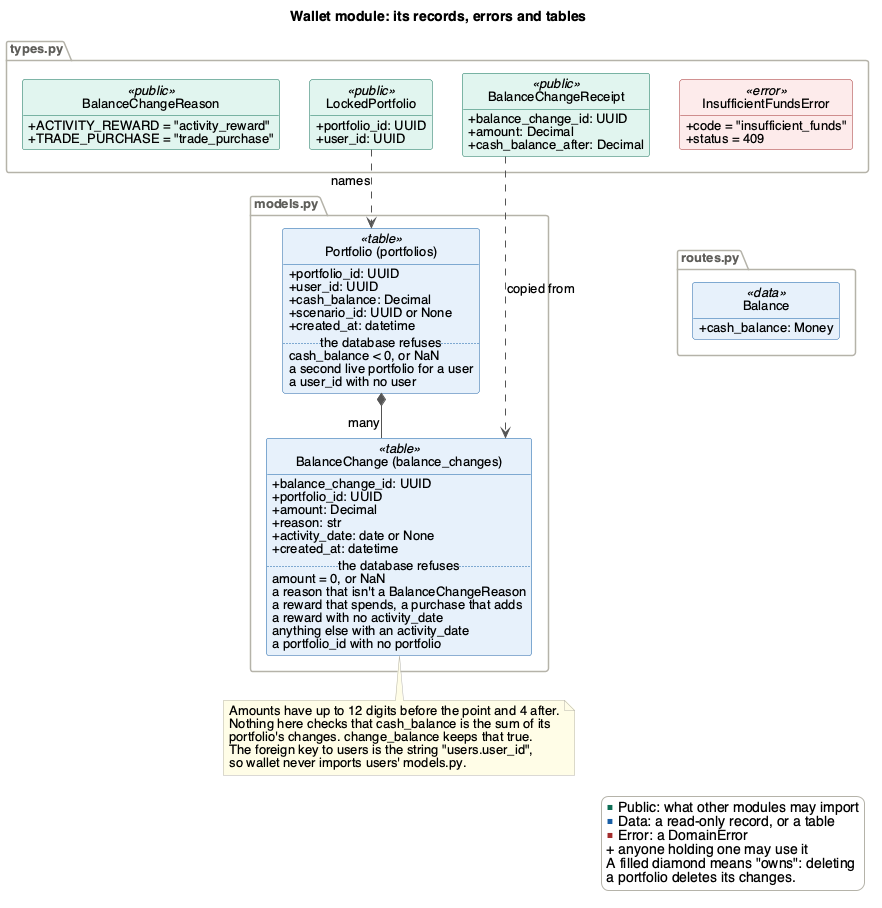

# Wallet module

Wallet holds each portfolio's currency, and is the one safe way to change it.
It records every change with its amount, time and reason (SEC-22).

| | |
|---|---|
| Folder | `src/backend/app/wallet/` |
| Tables | `portfolios`, `balance_changes` |
| Routes | `GET /v1/me/balance` |
| Uses | [users](users.md) |
| Used by | [trading](trading.md), and `app/scripts/seed_demo.py` |
| Issue | #279, #189 |

## Files



`interface.py` re-exports the four functions other modules may call from
`service.py`, and `queries.py` holds the reads. Nothing in wallet commits.

## Changing a balance

A route that changes money does three things:

```python
from app.wallet.interface import change_balance, lock_live_portfolio
from app.wallet.types import BalanceChangeReason

locked = lock_live_portfolio(db, user.user_id)
receipt = change_balance(db, locked, -cost, BalanceChangeReason.TRADE_PURCHASE)
db.commit()
```

1. **Lock first.** `lock_live_portfolio` locks the user's live portfolio row
   (a `SELECT ... FOR UPDATE`) until the transaction ends. Two requests for
   one portfolio, such as a buy and a step sync, then run one after the
   other, and the second sees what the first saved.
2. **Change with one guarded `UPDATE`.** `change_balance` adds the amount
   only if the balance stays at 0 or more, then records the change in
   `balance_changes`. It never commits. If the lock is skipped, the guarded
   `UPDATE` still keeps the balance at 0 or more.
3. **Commit once.** The route commits after every step has succeeded, so the
   payment and what it pays for are saved together or not at all.

**Read after the lock.** The lock only holds for what the route reads after
it. So read anything the amount depends on there, such as what a day's
rewards have paid so far (`activity_paid`). `activity_paid` also refuses a
`datetime` with `ValueError`.

`change_balance` refuses, before changing anything, a call that makes no
sense. It raises `ValueError` for:
- an amount that is 0, isn't a finite `Decimal`, or has more than 4
  decimals, which the database would round quietly. So when a reward comes
  to 0, don't call it
- a reward that takes currency away, or a purchase that adds it
- a reward without its `activity_date` (the `date` it pays for), anything
  else with one, or a `datetime` instead of a `date`

These are mistakes in the calling code, not refusals. The one refusal the
phone sees is:

| Code | Status | When |
|---|---|---|
| `insufficient_funds` | 409 | The balance would go below 0 (FR_MktAtomicTrade). Nothing changes |

## The balance route

`GET /v1/me/balance` sends the current user's live balance as text with 4
decimals, such as `{"cash_balance": "412.0000"}`. It only reads, so it
doesn't lock or commit. Without a user, [users](users.md) answers 401
`not_authenticated`.

## Making and deleting a portfolio

Each user has one live portfolio, the one with no `scenario_id`. Neither of
these commits:
- `create_live_portfolio` gives a user their live portfolio, at 0, and
  returns its ID.
- `delete_portfolio` is one `DELETE`. The database deletes what is under the
  portfolio in the same statement: its balance changes, and other modules'
  rows that point at it with `ON DELETE CASCADE`, such as trading's trades
  and holdings.

`seed_demo` makes the demo user's live portfolio, as
[users](users.md#the-demo-user-must-exist-first) explains. It only uses
users' and wallet's public files, never their tables. `reset` deletes
the old portfolio with `delete_portfolio`, which takes its changes with it,
and makes a new one with `create_live_portfolio`.

## Records, errors and tables



Wallet hands other modules read-only copies, never rows.
`BalanceChangeReceipt` holds the change's ID, its amount and the balance
after it. Trading stores that ID with each trade, so every trade points at
the change that paid for it.

The tables refuse bad rows, such as a balance below 0 or a reward that
spends, even from code that skips `change_balance`. They don't check that a
balance equals the sum of its changes (SEC-22). `change_balance` keeps that
true by changing both in one transaction, which is why nothing else may
change a balance.

## Design patterns

- **Plug-in:** `plugin.py` adds wallet's route and tables to the app. The
  kernel doesn't change.
- **Dependency injection:** the route gets the session and the user through
  `Depends`, so tests set the user.
- **Read-only records:** `LockedPortfolio` and `BalanceChangeReceipt` are
  frozen copies.
- **Lock token:** `change_balance` only takes the `LockedPortfolio` that
  `lock_live_portfolio` returns.

## Not built in the PoC

- Paying step rewards. `activity_reward` and `activity_paid`, which lets a
  step sync pay only the difference, are ready for activity (#190).
- Portfolios for market scenarios. Every portfolio is live, with no
  `scenario_id`.

## Tests

| File | What it checks |
|---|---|
| `test_wallet_money.py` | The lock, `change_balance` and the queries: exact amounts, every refusal changes nothing, the balance is the sum of its changes, a second transaction waits for the lock, wallet never commits |
| `test_wallet_tables.py` | The rules the tables keep by themselves |
| `test_wallet_balance.py` | `GET /v1/me/balance`: the balance as text, 0 for a new portfolio, 401 without a user |
| `test_seed_demo.py` | `seed` and `reset`: one demo user, a live portfolio at 0, a second run changes nothing, no old changes left |
| `test_test_setup.py` | Its `make_portfolio` tests: a live portfolio funded by one old reward and committed, and one for the demo user |
